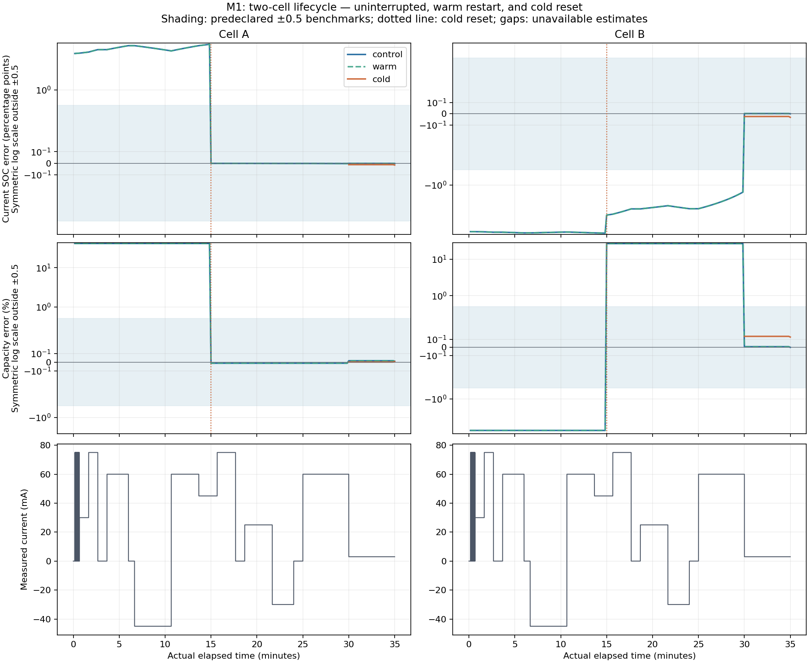

# mumble

C research reference for battery estimation from a 35 Hz voltage/current stream.

The goal is to **estimate what the available stimulus supports, retain earlier
evidence, and explicitly report what remains unknown**. The delivery target is
a runnable Cortex-M23 C estimator subsystem near 10 KiB SRAM.

**The continuous learning/retention contract is now frozen.** It declares one
short Cell A lifecycle gate, followed by one four-hour continuous Cell B
diagnostic under the unchanged public-split learner. Every 35 Hz interval is
scored for Q/SOC; plant, learner, RNG, weights and input position carry through
rest, weak use and renewed excitation. Capacity has no startup deadline.
The [contract](plans/continuous_learning_validation_001.json),
[design report](experiments/continuous_learning_validation_001/REPORT.md) and
[independent review](experiments/continuous_learning_validation_001/independent_review.json)
are complete. **No new primary was run and no estimator source changed.**
Next implement and qualify the separate continuous host harness before the
one declared staged execution; the candidate remains unpromoted.

**The requested parameter/state sensitivity analysis is complete.** At the
final saved estimate, a **19.24% τ₂ error** produces at most **1.571 mV** of
isolated voltage error across six declared future protocols. The complete
estimated vector stays below **0.987 mV** sampled voltage error, with substantial
signed compensation. A 30-minute 60 mA discharge adds **0.0441 SOC percentage
points** from capacity error alone; the full starting-state/capacity combination
ends at **+0.0361 points**. These are state-conditioned point predictions, not
coverage or arbitrary-input guarantees. See the
[sensitivity report](experiments/parameter_sensitivity_001/REPORT.md),
[summary](experiments/parameter_sensitivity_001/summary.json) and
[decision](experiments/parameter_sensitivity_001/decision.json).
The analysis changes no learner code and adds no estimator SRAM.

**The new two-component candidate learns capacity with later use on the first
declared comparison.** Its Cell B capacity error improves from **+13.16% at
900 seconds** to **+0.75% at 1800 seconds** and **+0.095% at 2100 seconds**;
the coincident control still ends at **−7.54%**. SOC meets the hard limit at
every available saved query from one second, and the preferred 0.5-point target
at all saved queries from 580 seconds. Both arms complete with zero rejected
corrections. See the [new report](experiments/nonlinear_hypothesis_001/REPORT.md)
and [compact result](experiments/nonlinear_hypothesis_001/summary.json).

The [user's timing clarification](plans/capacity_learning_horizon_001.json)
removes a capacity startup deadline while keeping prompt SOC and the declared
accuracy targets. The candidate is retained for further qualification;
**it is not promoted**. Its local ranges still miss truth, including at the
final accurate point. Complete target memory, broader performance, uncertainty
coverage and indefinite operation remain open. The
[continuous learning/retention validation contract](plans/continuous_learning_validation_001.json)
now defines the next bounded diagnostic and its implementation prerequisites.

The [current roadmap](docs/ROADMAP.md) has three deliverables: a small two-cell
end-to-end desktop demonstration, a desktop performance campaign including
about one year per selected cell, and the embedded implementation.
[M1 lifecycle integration is complete](docs/TRAJECTORY_INTEGRATION_001.md).
The [component-wise gain successor](experiments/bounded_online_002/REPORT.md)
has now completed one frozen two-cell experiment. It carries a full
16-coordinate mean/covariance factor with no retained sample history, owns
5,896 bytes of core objects and 7,064 bytes of fixed host objects, and preserves
exact warm continuation. Complete runtime and target costs remain additional.

**The gain change removes the observed global stalls, but the candidate is
not promoted.** Under the [current user targets](plans/estimation_targets_001.json),
SOC passes all 16 declared hard-limit checkpoints; capacity and joint passes
improve from 6/16 to 8/16. Cell B control still finishes at -7.54% capacity
error with a narrow provisional local interval. The two cold-reset arms also
reject 7 and 10 corrections. These are separate failures: the inaccurate
control arm rejects none. Both the [first result](docs/BOUNDED_ONLINE_001.md)
and this successor's first outputs remain preserved.

The [boundary transaction diagnostic](experiments/boundary_transaction_diagnostic_001/REPORT.md)
is complete. A minimal subnormal witness reproduces a negative R3 trial;
a diagnostic-only coordinate zero-gain fallback passes 625 combined assertions
with the same actual gain in the mean and full Joseph covariance. Prediction
preservation and exactly-once accounting pass. Production source remains
unchanged, and the original 17 rejections still lack individual failure records.
The [separate uncertainty decision](plans/local_uncertainty_decision_001.json)
keeps local precision as a diagnostic and application SOC/Q accuracy unresolved.
The [nonlinear-evidence design decision](experiments/nonlinear_evidence_design_001/REPORT.md)
is implemented in a separate C module: two public capacity alternatives retain
separate nonlinear states, full packed joint factors and predictive weights.
The numerical remedy is integrated in both new arms. **7,386 core and 188
checkpoint checks pass**; the owned subtotal is **7,152 bytes**. The complete
proposed allocation remains **10,032 bytes**, including unmeasured target
reserves. The original [900-second plan](plans/nonlinear_hypothesis_falsification_001.json)
is preserved; the [2100-second comparison](experiments/nonlinear_hypothesis_001/plan.json)
was frozen before inference in response to the timing clarification. Its one
declared execution is complete. Longer campaigns require a new bounded contract.

The [supplemental M1 belief audit](experiments/m1_belief_audit_001/REPORT.md)
reports all sixteen fitted quantities and applies the new targets to the frozen
M1 outputs, without new fits. M1's original failed gate remains preserved.

The [compact bounded implementation](docs/COMPACT_BOUNDED_001.md) now reduces
the B001/B002 paired-ingestion objects from 9,912 to 6,576 bytes. Its serialized
SOC/capacity diagnostic path owns 7,064 bytes, with a 7,984-byte host object and
own-source-stack partial peak. A single existing 73,500-sample replay preserves
the tested evidence and remainder bit-for-bit. External runtime, acquisition,
recovery and target costs remain additional. This fixed-chart component is
available for the next learner decision; it is not an autonomous estimator.

The completed full C study supplies the initial desktop reference. It retains
and replays history. Separate bounded event and integer certificate components
supply useful evidence and implementation pieces. Certificate004 proves
conditional all-prefix containment/availability for one uncertain RC mode,
while preserving three failed strict-learning assertions. These components
are not yet an integrated full-model streaming estimator or qualified firmware.
The [action plan](plans/trajectory_to_m23_001.json) ties further proof and
experiment work to specific delivery decisions.

## Start here

| Resource | Contents |
| --- | --- |
| [Delivery roadmap](docs/ROADMAP.md) | Two-cell lifecycle, desktop annual trajectories and Cortex-M23 delivery; finish lines and stop rules |
| [Machine-readable action plan](plans/trajectory_to_m23_001.json) | Immediate A1-A4 work, cases, reset semantics, campaign gates and resource boundary |
| [Accuracy target contract](plans/estimation_targets_001.json) | Capacity 5% / SOC 10 percentage points hard limits; 0.5% / 0.5 points preferred region; no nuisance-parameter precision mandate |
| [Frozen continuous validation contract](plans/continuous_learning_validation_001.json) | New A lifecycle gate and one continuous B four-hour diagnostic; exact chronology, carried state, all-sample target metrics, uncertainty and finite budgets |
| [Continuous validation design report](experiments/continuous_learning_validation_001/REPORT.md) | Why this scope, diagnostic admission versus campaign promotion, source review corrections, static verification and next implementation |
| [Continuous validation design review](experiments/continuous_learning_validation_001/independent_review.json) | Independent scientific, numerical-interface and accounting review; final contract hash and resolved findings |
| [Current sensitivity result](experiments/parameter_sensitivity_001/summary.json) | All sixteen saved parameter/state errors, six future regimes, joint compensation and charge-dependent SOC consequences |
| [Sensitivity report and figures](experiments/parameter_sensitivity_001/REPORT.md) | Normalized local derivatives, exact finite error effects, three saved anchors and explicit interpretation limits |
| [Sensitivity decision](experiments/parameter_sensitivity_001/decision.json) | Preserve candidate; assess application outputs under declared use, with no universal nuisance precision or automatic duration campaign |
| [Sensitivity publication](provenance/parameter_sensitivity_001_publication.json) | Executed versus published source/result trees and preserved original development history |
| [Current learner result](experiments/nonlinear_hypothesis_001/summary.json) | Two-arm 2100 s comparison complete; later capacity learning supported, local uncertainty still fails, candidate retained for qualification |
| [Learning report and figure](experiments/nonlinear_hypothesis_001/REPORT.md) | Prompt SOC, later capacity, first versus retained target attainment, component weights and remaining limits |
| [Capacity timing amendment](plans/capacity_learning_horizon_001.json) | No capacity startup deadline; prompt SOC, unchanged hard/preferred accuracy targets, continuous long-trajectory requirement |
| [Preserved mechanism decision](experiments/nonlinear_hypothesis_001/decision.json) | Keep public split for controlled qualification; its requested continuous validation design is now frozen |
| [Learner publication](provenance/nonlinear_hypothesis_001_publication.json) | Original execution versus published commit identities and preserved development bundle |
| [Prior nonlinear-evidence design](experiments/nonlinear_evidence_design_001/summary.json) | Two persistent public capacity components selected; saved-evidence audit and proposed 10,032-byte allocation; no inference in that design study |
| [Two-component contract](plans/nonlinear_evidence_design_001.json) | Public moment split, single-use mixture evidence, complete staging, distinct evidence cursors, resource and query semantics |
| [Completed bounded comparison plan](experiments/nonlinear_hypothesis_001/plan.json) | Two existing B 2100 s arms; 900 s diagnostic, late capacity learning and weak-tail retention; frozen before execution |
| [Historical 900 s plan](plans/nonlinear_hypothesis_falsification_001.json) | Preserved unexecuted plan; timing and stopping rule superseded by the user's pre-inference clarification |
| [Design publication](provenance/nonlinear_evidence_design_001_publication.json) | Original execution versus published source/result identities and preserved bundle |
| [Completed boundary diagnostic](experiments/boundary_transaction_diagnostic_001/summary.json) | Minimal numerical witness, 625 passing fixture assertions, selected remedy and preserved transaction invariants; no cell replay |
| [Boundary remedy decision](experiments/boundary_transaction_diagnostic_001/decision.json) | Finite actual-mean coordinate zero-gain fallback tested in a diagnostic variant; production source unchanged |
| [Boundary diagnostic publication](provenance/boundary_transaction_diagnostic_001_publication.json) | Identical published source/result trees and preserved original execution commits |
| [Separate uncertainty decision](plans/local_uncertainty_decision_001.json) | Local precision retained; application accuracy unresolved uniformly; capacity bias and original failed gates remain open |
| [Current bounded online result](experiments/bounded_online_002/REPORT.md) | Component-wise gain removes global stalls; capacity, local qualification and 17 cold correction rejections still block promotion |
| [Bounded online summary](experiments/bounded_online_002/summary.json) | Compact result and selective links; read before raw outputs |
| [Bounded online publication](provenance/bounded_online_002_publication.json) | Verified canonical trees and preserved original execution commits |
| [Original numerical diagnostic plan](plans/boundary_transaction_diagnostic_001.json) | Preserved queued plan; completed outcome is in the boundary diagnostic summary above |
| [First bounded online result](docs/BOUNDED_ONLINE_001.md) | Preserved predecessor, common-gain stalls and separate wrong narrow capacity beliefs |
| [M1 full-belief audit](experiments/m1_belief_audit_001/REPORT.md) | Full sixteen-quantity errors, current-state transport and supplemental target scores without rerunning M1 |
| [M1 lifecycle report](docs/TRAJECTORY_INTEGRATION_001.md) | Two-cell operation, exact warm continuation, cold reset, preserved usefulness failure and next blocker |
| [M1 compact summary](experiments/trajectory_integration_001/summary.json) | Functional/usefulness outcomes, resource costs and selective evidence links |
| [M1 independent scores](experiments/trajectory_integration_001/scores.json) | Post-inference accuracy, convergence, local qualification and reset recovery |
| [Compact bounded implementation](docs/COMPACT_BOUNDED_001.md) | Shared configuration, selective transactions and full-joint SOC/Q diagnostics; measured storage and exact core comparison |
| [Compact result summary](experiments/compact_bounded_001/summary.json) | One fixed-anchor replay, first outcome, source identity, memory and remaining limits |
| [Bounded uncertain RC mode](docs/UNCERTAIN_RC_004.md) | Continuous parameter box, all-prefix width/containment proofs, retained learning and three preserved usefulness failures |
| [Current uncertain-RC contract](proofs/indefinite_stability_004/contract.json) | Fixed nuisance box, interval forcing, immutable evidence semantics and explicit open gates |
| [Uncertain-RC lemma ledger](proofs/indefinite_stability_004/lemmas.json) | U1-U6 plus the retained-reference coordinate identity |
| [Compact current outcome summary](experiments/indefinite_stability_004/summary.json) | Selective results, failures, memory and next work; read before the full receipt |
| [Uncertain-RC primary receipt](experiments/indefinite_stability_004/receipt.json) | Complete frozen evidence; completed with all soundness gates passing and overall acceptance false |
| [Conditional battery provider](docs/BATTERY_CERTIFICATE_003.md) | Composed all-prefix proof, retained SOC/capacity learning, comparison and complete owned-memory accounting |
| [Known-RC provider contract](proofs/indefinite_stability_003/contract.json) | Restricted model, integer units, ranges, observation semantics and historical open gates |
| [Provider lemma ledger](proofs/indefinite_stability_003/lemmas.json) | Eight arguments plus composed conditional availability |
| [Provider audit receipt](experiments/indefinite_stability_003/receipt.json) | Frozen short experiment, exact oracle, boundary canaries, retained-history comparison and resources |
| [Implemented stability contract and lemmas](docs/STABILITY_CONTRACT_002.md) | Exact integer kernels, all-prefix induction arguments, conditional finite evidence semantics and scoped host memory |
| [Inherited arithmetic contract](proofs/indefinite_stability_002/contract.json) | Concrete inputs, arithmetic, retention semantics and historical integration gates |
| [Arithmetic lemma ledger](proofs/indefinite_stability_002/lemmas.json) | Six claims, premises, source correspondence and limits |
| [Integer audit receipt](experiments/indefinite_stability_002/receipt.json) | 3,588 passing exact-reference checks; finite falsification, not an endurance proof |
| [Indefinite numerical stability](docs/INDEFINITE_NUMERICAL_STABILITY_001.md) | Lifetime proof contract, conditional invariants, finite-state limitations and seven small counterexamples |
| [Earlier proof contract](proofs/indefinite_stability_001/contract.json) | Preserved initial acceptance gates and evidence/arithmetic questions |
| [Nonlinear remainder experiment](docs/BOUNDED_EVENT_002.md) | Sparse joint-parameter bound, useful conditional tail trial, conservative region failure, preserved arithmetic failures and full memory costs |
| [Remainder receipt](experiments/bounded_event_002/receipt/receipt.json) | 654/672 unchanged checks pass; 18 near-roundoff prediction-norm failures retained and diagnosed separately |
| [Bounded event experiment](docs/BOUNDED_EVENT_001.md) | Fixed-memory C evidence design, complete host memory accounting, successful local carry and explicit failure witnesses |
| [Corrected bounded receipt](experiments/bounded_event_001/receipt_scaled_givens/receipt.json) | 72 passing checks; original failed receipt retained separately |
| [Implementation guide](README.txt) | Model, units, constraints, interfaces, assumptions and reproduction commands |
| [Study report](report/SCM-35Hz-Results.html) | Self-contained HTML report; download and open locally |
| [Convergence figure](report/SCM-35Hz-Convergence.png) | Stimulus and six-run error versus elapsed physical time |
| [Knowledge figure](report/SCM-35Hz-Knowledge.png) | Per-target unexcited, unresolved and provisional statuses |
| [Project state](PROJECT_STATE.json) | Compact machine-readable checkpoint and next work |
| [Continuation handoff](handoff/CONTINUE.json) | Repository-based instructions and context for the next agent |
| [Study specification](specification.json) | Experiment contract |
| [Input manifest](data/manifest.json) | Six traces, truth for scoring, stimulus and input hashes |
| [Results](results/) | Frozen fit outputs, profiles, compression comparison and verification receipts |
| [Import provenance](provenance/) | Original release hashes and repository portability checks |

## Current roadmap

| Milestone | Status and finish line |
| --- | --- |
| Foundations | Completed 35 Hz reference and bounded/proof studies preserved; current limits and failures remain recorded |
| **M1: Two-cell end-to-end desktop demonstration** | **Functionally complete.** Warm continuation and cold reset pass; the separate usefulness gate fails for cell B at 900 s and is preserved |
| **M2: Desktop performance and year-scale behavior** | **A4: split candidate retained; continuous validation contract frozen.** Implement/qualify its host harness, then execute the staged diagnostic once. Uncertainty, broader performance and lifetime behavior remain open |
| **M3: Cortex-M23 near 10 KiB** | Complete simultaneous SRAM and timing account, actual target execution, recovery parity and relevant lifetime obligations |

The fixed R/tau partition is a possible remedy for a demonstrated target-quality
blocker. It is no longer the automatic next study. The full replay reference
and restricted hard-bound provider have different model/evidence semantics;
the [roadmap](docs/ROADMAP.md) keeps their roles explicit. One finite year of
simulation adds endurance evidence and does not replace the indefinite-runtime
proof requirement.

## Build and run

The C executable needs a C99 compiler, `make` and `libm`. Python is only needed
for the combined test target, orchestration, independent validation and plots.
The separate integer provider targets, `make test-certificate` and
`make test-certificate-box`, link without libm and are included in `make test`.

```bash
git clone https://github.com/tumblewhead/mumble.git
cd mumble
make

python3 -m venv .venv
. .venv/bin/activate
python3 -m pip install -r requirements-reference.txt
make test

./build/scm_estimator \
  --data data/cell_a_35hz_s202610240.csv \
  --case cell_a_35hz_s202610240 \
  --modes 3 --method full --sigma 0.001 \
  --starts 3 --max-iter 120 --prefix 31500
```

The example fits the first 900 seconds and prints estimates and uncertainty
qualification as JSON. Sample index is the ordering authority, with an explicit
interval in seconds. Positive current discharges; current is measured in A and
voltage is sampled at the end of each constant-current interval.

Use `--ocv path/to/ocv.csv` for a measured 25 C curve with columns `z,voltage`.
The included benchmark uses a known illustrative curve because the numerical
measured curve was not supplied. It must not be described as real-cell validation.

## Completed M1 lifecycle demonstration

The [frozen primary receipt](experiments/trajectory_integration_001/primary/receipt.json)
records one 20-fit campaign on the two existing 35-minute traces. Fresh-process
warm restores reproduce the uninterrupted numerical queries, fitted results
and canonical checkpoint bytes exactly, excluding timing fields. Cold reset at
900 seconds clears inferred knowledge while preserving the known input position
and clock; both cells relearn useful SOC/capacity by the first scheduled
post-reset fit at 1,800 seconds. Small API tests cover missing voltage,
unknown-input gaps, invalid persistence, ordering and counter failures.

**Functional acceptance passed; overall usefulness acceptance failed.** With
the frozen sparse fit schedule, cell B reaches the iteration limit at 900
seconds, with SOC error of -3.96355 percentage points and capacity error of
+26.6298%. Both targets remain explicitly unresolved, without trusted local
ranges. Both cells pass the inherited SOC/capacity accuracy thresholds at
1,800 and 2,100 seconds; the cold branches also pass their two recovery
checkpoints. These [independent scores](experiments/trajectory_integration_001/scores.json)
preserve the failed checkpoint and the unknown period after reset.



The session retains complete history and constructs the original full fitting
problem on demand. The measured final successful-fit subtotal is 49,470,676
requested bytes, before additional process, stack and persistence costs.
M1 supplies the comparison harness for a bounded learner. It does not qualify
this sparse schedule for long-run performance, prove indefinite stability or
establish Cortex-M23 suitability. See the
[integrated report](docs/TRAJECTORY_INTEGRATION_001.md) for the memory boundary
and separate numerical, accuracy and uncertainty results.

## Completed 35 Hz study

The main campaign contains two synthetic cells, three noise seeds per cell,
73,500 samples per trace, and ten chronological prefixes: **60 fits**. All
sixteen model quantities, including entering states, are unknown to fitting.
Truth enters independent scoring only.

| Result across six runs | Observation |
| --- | --- |
| Current SOC error below 0.5 percentage points | From the 600 s checkpoint onward |
| Capacity error below 0.5% | From the 900 s checkpoint onward |
| Every resistance and RC time constant below 10% point error | By the 220 s checkpoint |
| Worst final current-SOC error | 0.00350642 percentage points |
| Worst final capacity error | 0.0163354% |
| Numerical stopping status | 50 converged; 10 iteration limits |

“From” means the first tested checkpoint passing the threshold at that and every
remaining tested checkpoint. These are stimulus-specific results under a matched
25 C model, exact current/time, known OCV, and independent 1 mV Gaussian noise.
Local precision and truth accuracy are reported separately. Some R0 and fastest
pole estimates remain unresolved despite useful SOC/capacity estimates.


The supplemental event-local comparison retains 723 one-anchor features or
1,442 five-anchor features from 73,500 voltage samples, across 106 event blocks.
Both preserve close fits in the two tested traces. Explicit basis storage still
costs megabytes and increases CPU time. Small feature payload is not complete
firmware memory consumption.

The final quiet-window control shows why earlier evidence matters. A complete
history fit retains useful SOC/capacity estimates; a fit to the last weak-use
window alone remains unresolved despite a similar voltage RMSE.

## Reproduce or inspect

Included results can be inspected without repeating optimization. To regenerate
the study, see [README.txt](README.txt). These commands overwrite their named
generated outputs, so use a work branch when making a new campaign:

```bash
git pull --ff-only
git switch -c experiment/my-next-study
make
make test
OPENBLAS_NUM_THREADS=1 python3 tools/run_streaming.py --workers 3
OPENBLAS_NUM_THREADS=1 python3 tools/run_profiles.py --workers 3
OPENBLAS_NUM_THREADS=1 python3 tools/run_compression.py
MPLCONFIGDIR=/tmp/mumble-mpl python3 tools/make_report.py
git status --short
```

Record the source revision, commands, assumptions and validation before committing
new results. Keep machine-to-machine handoffs compact JSON. Source and evidence
belong in this repository; chat summaries are supporting context.

## Implementation map

- `src/scm_model.c`, `include/scm_model.h`: chronological state propagation and sensitivities.
- `src/scm_features.c`, `include/scm_features.h`: orthogonal projections.
- `src/scm_estimator.c`, `include/scm_estimator.h`: host variable-projection estimator.
- `src/scm_assess.c`, `include/scm_assess.h`: fixed-workspace per-target qualification.
- `src/scm_session.c`, `include/scm_session.h`: desktop retained-history lifecycle, ordered ingestion, scheduled fitting, freshness and reset semantics.
- `src/scm_session_checkpoint.c`, `include/scm_session_checkpoint.h`: versioned named-field persistence, complete journal and staged restore without refitting.
- `src/scm_evidence.c`, `include/scm_evidence.h`: bounded fixed-chart event evidence and guards.
- `src/scm_remainder.c`, `include/scm_remainder.h`: paired chronological ingestion and sparse analytic nonlinear-remainder budget checks.
- `src/scm_compact_*.c`, `include/scm_compact_*.h`: smaller alternative evidence/remainder layout and focused SOC/Q diagnostics retaining the full joint matrix; original APIs remain the comparator.
- `src/scm_stable.c`, `include/scm_stable.h`: proved integer charge, attenuation, scalar-state and finite-mask kernels.
- `src/scm_certificate.c`, `include/scm_certificate.h`: conditional battery certificates, contracting SOC0 intervals and outward SOC/capacity queries.
- `src/scm_certificate_box.c`, `include/scm_certificate_box.h`: one fixed uncertain RC mode with outward forcing/attenuation and the same retained target semantics.
- `src/main.c`: CSV/JSON host CLI.
- `tests/`: model, estimator, projection, constraint and qualification checks.
- `tools/`: data generation, runners, independent scoring and report construction.
- `reference_binaries/`: preserved Linux x86-64 executables for exact study provenance;
  build the source for your own host. These are not MCU images.

## Next work and limits

The [two-component learner comparison](experiments/nonlinear_hypothesis_001/REPORT.md)
and the [parameter sensitivity analysis](experiments/parameter_sensitivity_001/REPORT.md)
are complete. Preserve the completed M1 campaign, both older bounded candidates,
the original 60-fit study, failed uncertainty diagnostics and all source identities.
The latest canonical work branch is `design/continuous-learning-validation-001`.

The [frozen continuous validation contract](plans/continuous_learning_validation_001.json)
closes the sensitivity decision's next design task, with zero primary runs.
On `implementation/continuous-learning-validation-001`, implement only the new
stateful generator, continuous host adapter, scorer and bounded preflight fixtures.
Preserve the seven pinned learner source blobs and the old 73,500-sample probe.
Freeze/review executable source and binary identities before inference, then run
the A lifecycle gate and conditional four-hour B diagnostic once. Accuracy misses
remain visible and do not invent a capacity startup deadline; validity failures
stop the study. No day/week/annual campaign or full qualification follows
automatically. See the [design decision](experiments/continuous_learning_validation_001/decision.json).

The original two-cell traces include hysteresis and multiple unknown RC modes.
They are outside certificate004's restricted contract; do not insert truth to
make that provider applicable. A general bounded streaming learner remains a
real gap after the completed desktop integration. Attention and RC partitioning
remain focused decision experiments when their result can change the next
learner choice.

Physical error bounds, uncertain current/time/OCV, drift and target resources
remain open. Hard certificate support, Gaussian local precision, point accuracy,
solver convergence and validated coverage are different claims. No reset or
parameter change may silently discard the evidence semantics.

Follow the [delivery roadmap](docs/ROADMAP.md) for campaign sizing, complete
10 KiB accounting and the rule that every new proof or experiment must serve
a named milestone gate. The older evidence below is preserved as supporting
work rather than a serial queue of mandatory refinements.

## Indefinite-runtime stability proof gate

The initial review separates numerical safety, fidelity, earlier-evidence
retention and conditional usefulness. It proves conditional time-uniform
error lemmas for dissipative states and bounded exact quantized charge,
and finite-state obstructions to unrestricted all-history likelihood
and empirical-mean accuracy. The existing Gaussian C/libm estimator remains
outside a full lifetime proof.

A preregistered small experiment reproduces seven mechanisms, including
absorbed increments in the production QR and remainder updates and atomic
rejection at the counter limit. These are scalar or deliberately constructed
API boundary states; no deployed-lifetime or physical-history reachability
claim is made. All seven reproduced mechanisms are counterexample evidence,
not a passing indefinite-stability result.

Read the [proof report](docs/INDEFINITE_NUMERICAL_STABILITY_001.md) and
[claim ledger](proofs/indefinite_stability_001/claims.json).
The [second checkpoint](docs/STABILITY_CONTRACT_002.md) selects a concrete
finite-certificate research contract and implements libm-free integer kernels.
Its source-level proofs cover exact bounded charge, outward attenuation,
invariant scalar-state enclosures, conditional uniform interval width, exact
historical cell retention and conditional eventual refinement. The audit checks
these against exact rational/integer references. Written proofs are independently
reviewed, without a machine-checked C or compiler-correctness claim.

The [third checkpoint](docs/BATTERY_CERTIFICATE_003.md) supplies the restricted
battery producer and target query that were open at stability002. It composes
the integer kernels with immutable capacity bins and contracting SOC0 ranges,
proves whole-observation transactions, and closes conditional all-prefix
availability and containment for its declared static physical domain. A frozen
informative/quiet/renewed-excitation experiment demonstrates retained capacity
learning while keeping unexcited capacity explicitly unresolved.

The existing 35 Hz, B001 and B002 results and their interpretations remain
unchanged. Full-model uncertainty, physical premise validation, delivery and
recovery, coverage and Cortex-M23 qualification remain open. The historical
68-byte primitive subtotal was extended in003 to 2,128 bytes of owned objects
plus 1,120 bytes of loose own-source stack. The
[fourth checkpoint](docs/UNCERTAIN_RC_004.md) admits one continuous fixed RC box
and totals 2,152 plus 1,320 bytes. It proves the conditional lifetime invariants
while retaining three failed strict-learning assertions from the small audit.
These subtotals remain short of a complete firmware memory account.

## Bounded event prototype

`scm_evidence` consumes each actual interval/current/voltage observation once,
carries model state and sensitivities across events, and merges event-local
augmented QR factors into one aggregate. It retains no sample history or
explicit Q basis. Source/index checks prevent duplicate ingestion in a live
bank. Parameter-radius, physical-domain and residual diagnostics expose
unsupported updates without deleting evidence.

The corrected small experiment preserves the reference's unresolved 400 s
SOC/capacity status, reproduces informative 900 s local precision and carries
earlier information through the final quiet tail. All 72 checks pass. The
nominal-chart control fails: local rank/precision alone cannot qualify a
poorly placed nonlinear model. A separate inside-radius witness shows that
the current radius is not a nonlinear likelihood-error certificate.

On this host, the persistent bank plus update workspace uses 7,512 bytes;
the simultaneous snapshot/diagnostic/solve objects bring that subtotal to
18,408 bytes before additional configuration, input, stack and runtime costs.
The complete approximately 10 KiB subsystem target is not achieved.

```bash
make build/scm_evidence_probe test-evidence evidence-stack
OPENBLAS_NUM_THREADS=1 python3 tools/run_bounded_event.py \
  --output-dir experiments/bounded_event_001/my_new_receipt
python3 tools/measure_bounded_memory.py \
  --probe-result experiments/bounded_event_001/my_new_receipt/carry_1800_to_2100.json \
  --output experiments/bounded_event_001/my_new_memory.json
```

Both helpers refuse existing outputs. The original 60-fit campaign is not
needed to reproduce this small experiment. Read the
[design and results](docs/BOUNDED_EVENT_001.md) before treating local evidence
as a nonlinear estimate.

## Nonlinear remainder prototype

`scm_remainder` retains 19 sparse Hessian-envelope norms and bounded propagation
state on the original joint chart. It advances through the same atomic paired
ingestion as the evidence bank. It supports the smooth illustrative OCV and
reports a real-arithmetic prediction/NLL error bound; ordinary double arithmetic
is explicitly unvalidated.

At the final quiet tail, the conditional SOC/capacity trial has an analytic
NLL-error bound of 0.0041192 and an upper-cost improvement of 0.1314269 under
the declared 0.1 budget. The full joint step and every whole-region guarantee
remain over budget. Earlier unresolved directions remain unresolved; the
nominal bad-chart control allows no update. No trial is applied or used to
reset the chart.

The four-run receipt retains 18 failed prediction-norm checks near machine
precision at already fitted anchors. Separate higher-precision diagnostics
investigate that floor without changing the original result or tolerances.
All original NLL-error gates pass. The paired ingestion objects use 9,912 bytes,
and the listed project stack plus input raises that partial total to 10,672
bytes before external costs. The full diagnostic object set uses 20,856 bytes.

```bash
make test-remainder build/scm_remainder_probe
python3 tools/run_remainder.py \
  --output-dir experiments/bounded_event_002/my_new_receipt
python3 tools/measure_remainder_memory.py \
  --probe-result experiments/bounded_event_002/my_new_receipt/carry_1800_to_2100.json \
  --output experiments/bounded_event_002/my_new_memory.json
```

The runner's nonzero exit records the preserved numerical failures on this
host. Read the [remainder report](docs/BOUNDED_EVENT_002.md) and selective
evidence links before interpreting an analytic-budget pass as qualified
machine arithmetic, nonlinear convergence, or validated coverage.

The original study release manifest is preserved in
[`provenance/study_release.json`](provenance/study_release.json). The original
import adapted documentation and verification-helper paths. The later bounded
prototype is recorded separately; original study outputs and numerical
reference sources remain preserved.
