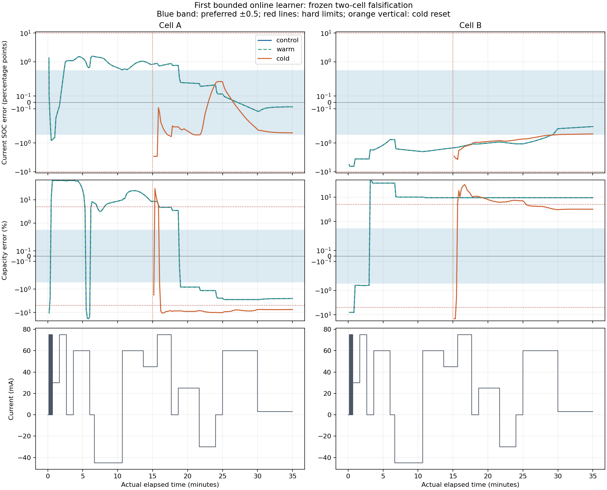

# First autonomous bounded online learner

The first bounded learner passes the fixed-storage and lifecycle checks, but it fails the capacity
accuracy gate. Preserve this result as a measured failure; do not promote it to the year-long
variation campaign or Cortex-M23 qualification. The next change is one boundary-aware gain update,
followed by the same short falsification. Narrow, biased capacity beliefs remain a separate
rejection reason.

The completed run contains 12 processes and 378,000 input deliveries, with no batch optimizer calls.
All warm continuations reproduce control exactly. Of 16 declared arm/checkpoint comparisons, SOC
passes its hard limit in all 16, capacity and joint accuracy pass in 6, and joint preferred accuracy
passes in 0. See the [receipt](../experiments/bounded_online_001/primary/receipt.json),
[scores](../experiments/bounded_online_001/scores.json) and [independent
review](../experiments/bounded_online_001/independent_review.json).

## Product targets

| Quantity | Hard limit | Preferred region; diminishing gains below this |
| --- | ---: | ---: |
| Capacity | Absolute relative error ≤5% | ≤0.5% |
| Current SOC | Absolute error ≤10 percentage points | ≤0.5 percentage points |

These are point-error acceptance requirements against scoring truth. They do not certify an
estimator error bound or uncertainty coverage. SOC percent is interpreted as percentage points of
full charge, consistently with M1. There is no universal subpercent goal for every nuisance
parameter. The original M1 acceptance record stays frozen; the new thresholds are applied in a
supplement. Source: [active requirements](../plans/estimation_targets_001.json).

## Why about 7 KiB and about 50 MB were different

| Implementation and measured scope | Bytes | What it retains |
| --- | ---: | --- |
| M1 session plus requested fit storage, 73,500 samples | 49,470,676 | Raw observations and cached rows for historical nonlinear reevaluation |
| Earlier compact fixed-chart subsystem, complete owned objects | 7,064 | Conditional information and remainder accounting within a declared chart |
| This autonomous learner, state + workspace + query | 5,848 | A 16-coordinate mean and full covariance factor, with fixed staging |
| This learner, all named fixed host driver objects | 7,016 | Core plus configuration/sample copies, CSV buffers and checkpoint paths |

M1 caches 80 doubles per sample: 640 bytes ×73,500 =47,040,000 bytes of design rows. It also
requests 588,000 bytes of residuals, a 2,072-byte fixed solver problem and 1,840,604 bytes for the
session and journal. The large allocation is primarily reusable historical computation, not a giant
belief mean. The 7,064-byte predecessor had a different inference contract: it was a fixed-chart
evidence subsystem, not an autonomous broad-prior nonlinear learner. Similar byte counts therefore
did not establish equivalent functionality or accuracy. These scopes are documented in the [memory
account](../experiments/bounded_online_001/memory_accounting.json).

The new state is 2,408 bytes: 128 bytes of means, 2,048 bytes of full square factor, and 232 bytes
of configuration, ledger, diagnostics and padding. Its 2,920-byte workspace includes a prospective
state and four 16-double vectors; the simultaneous query is 520 bytes. A complete checkpoint is
2,440 bytes on storage, encoded field by field using existing workspace rather than a second
whole-file RAM buffer. Two records can coexist during atomic replacement.

Named host objects plus the largest reviewed own-source stack path total 8,136 bytes. This is a
partial host subtotal. Library stack/allocations, acquisition and interrupt buffers, target ABI,
software binary64 cost, flash persistence, linker placement and runtime remain outside it. The
256-byte support arrays also need an explicit target placement. The 8,192-byte core gate passes; a
complete 10,240-byte Cortex-M23 subsystem has not been qualified.

## What M1's full belief-vector error actually looked like

M1 estimates 11 static parameters and 5 entering-state quantities. A raw norm mixing ohms, seconds,
volts, Ah and SOC would have no useful interpretation. The supplemental audit divides coordinate
errors by the existing engineering scales and reports `sqrt(sum(scaled_error_i²)/16)`. This
dimensionless RMS is scale-dependent, not a percentage or posterior distance.

| Nominal fit time | A control scaled RMS | B control scaled RMS |
| --- | ---: | ---: |
| 10 s | 1.083001 | 1.112179 |
| 900 s | 0.030027 | 1.087344 |
| 1800 s | 0.024791 | 0.010897 |
| 2100 s | 0.023706 | 0.011203 |

At the final full-history fit, the largest positive-parameter errors were A's tau2 at −2.12667% and
B's tau1 at −1.39169%. A's initial fast RC voltage error was +2.46183 mV, while its current fast RC
voltage error was only −0.00545 mV. Entering state and current state must remain separate. Final
cold-path RMS was 0.021984 for A and 0.033326 for B. Cold B still had R0 error +10.2752% and R1
error −7.02792%, alongside capacity +0.12653% and current SOC −0.03137 pp.

Numerical convergence, truth accuracy, local precision and coverage remain different questions.
Early rest had rank 6/16 for A and 7/16 for B. B at 900 s had full local rank but hit the iteration
limit; all 16 physical reports were unresolved. A's final R0 and tau1 remained locally unresolved
despite small point errors. Under the new product limits, M1 passes 14/16 joint checkpoints, all 14
also preferred; the two identical B900 control/warm capacity failures remain at +26.6298%. The
original usefulness failure is unchanged.

The [M1 audit report](../experiments/m1_belief_audit_001/REPORT.md) contains all 16 final errors and
current-state errors; its [summary](../experiments/m1_belief_audit_001/summary.json) and selectively
linked records preserve every fit. This supplement made no new optimizer calls.

## The bounded candidate and frozen experiment

The candidate is a joint square-root EKF with 16 means and a full 16×16 factor `S`, where `P=S*Sᵀ`.
Eleven coordinates are static parameters; five are current SOC, three RC voltages and hysteresis
state. Each actual input interval advances the physical state once. Each available voltage gets one
correction opportunity. The mean and factor carry earlier approximate information without raw
replay, fading, process noise or adding a historical posterior as independent evidence.

The full square factor avoids per-sample QR while retaining cross-correlations. Sparse prediction
updates five factor rows; correction has fixed O(16²) work. The broad public prior is fixed before
the run. Mean support limits use one common gain multiplier, and covariance uses the same gain
through a Joseph-equivalent factor update. This is a local prior-conditioned Gaussian approximation,
not an exact compressed nonlinear historical likelihood. See the [frozen
plan](../experiments/bounded_online_001/plan.json) and [algebra/source
review](../experiments/bounded_online_001/design_review.json).

The two existing cells each supply 73,500 observations over 2,100 seconds at nominal 35 Hz, with
actual intervals and ordering preserved. Each cell has an uninterrupted control, four fresh-process
warm segments, and a cold path that restores the 900 s control checkpoint then discards belief for
the public prior. Warm boundaries are 12, 1200, 1850 and 2100 s. No truth enters inference; scoring
begins after every process finishes. No full-cell development sweep or after-result tuning was used.
Temperature stays at the existing 25°C setting; temperature variation and end-of-discharge behavior
remain outside this run.

## Measured result

| Final path, 2100 s | SOC error, pp | Capacity error, % | Capacity status | Current-vector scaled RMS |
| --- | ---: | ---: | --- | ---: |
| A control/warm | −0.06998 | −2.53130 | provisional | 0.405743 |
| B control/warm | −0.37847 | +9.38929 | unresolved | 0.893262 |
| A cold | −0.47819 | −7.48501 | provisional | 0.549717 |
| B cold | −0.49357 | +3.17243 | provisional | 0.164966 |

All four final SOC points are within the preferred 0.5 pp region; capacity prevents joint preferred
success. The new vector uses current z/v/h and a different coordinate chart from M1's entering-state
vector. Its RMS is not a direct like-for-like improvement ratio against the M1 RMS table. At
declared checkpoints, A control/warm fail capacity at 900 s (+8.45003%); B control/warm fail at all
three checkpoints, and A cold fails at both. These failures explain the 6/16 joint hard passes.
Saved-query precision/status is reported separately from point error in the
[scores](../experiments/bounded_online_001/scores.json).

The figure uses saved nominal 10 s queries plus lifecycle events and a symmetric logarithmic error
axis. Overlapping warm/control curves reflect exact equality. Saved-query maxima and first/sustained
times are sampled diagnostics, not bounds on every intervening sample. No year-scale result is
implied by duplicated arms.

## Two distinct failure mechanisms

**Common-gain stall.** B control applies zero observation gain on 71,928 of 73,500 updates:
97.8612%. At the 10 s saved query, tau3 is at its 30 s upper bound and 303 updates have zero gain.
At the final query, gamma-minus is at its 1,200 upper bound; the last positive-gain evidence index
is 58,726, leaving 14,774 samples of evidence age. One outward nuisance correction at a bound can
set the common gain to zero for all coordinates, including SOC and capacity. Known physical
propagation and chronology still continue correctly.

**Wrong narrow capacity.** A cold ends at 0.05550899 Ah against true 0.060 Ah, an error of
−7.48501%, while its reported local two-SD interval is only [0.05542132, 0.05559680] Ah. Its
innovation EWMA is about 1.04493. A narrow local range and a plausible innovation diagnostic do not
establish calibrated capacity. There are 54 provisional capacity hard-error breaches among saved A
control queries, the identical 54 in warm, 113 in A cold, and 51 in B cold. Warm counts are
duplicated evidence, not independent repetitions.

Cold counters are cumulative: A's final 7,503 zero gains include 6,069 from before reset; B's final
30,260 include 29,965 before reset. Thus the new suffix has 1,434/42,000 zero gains for A (3.41%)
and 295/42,000 for B (0.70%). A cold's capacity bias persists despite relatively few post-reset
stalls. Fixing the common gain is not established as a cure for overconfidence. Detailed witnesses
and interpretation are in the [independent result
review](../experiments/bounded_online_001/independent_review.json).

## Verification and limits

The strict full C suite and focused address/undefined-behavior sanitizers pass. The new core has
2,377 checks, including dense Joseph comparisons; checkpoint tests have 64 checks. All 430 warm
query records independently match control state/resources exactly, and all 10 recorded checkpoint
hash/size pairs agree. Cold resets restore the public mean/SD and clear availability; each cold
suffix adds exactly 42,000 updates. The scoring audit passes 104 checks, with maximum independent
truth-coordinate difference 9.08e−13. See [build
evidence](../experiments/bounded_online_001/build_checks.json) and the [scoring
audit](../experiments/bounded_online_001/scoring_audit.json).

These establish tested arithmetic, fixed ownership and lifecycle behavior. They do not prove
indefinite floating-point stability, all-prefix availability, global nonlinear convergence or
validated coverage. The experiment is two 35-minute trajectories. The host control processes take
about 0.136 s and 0.127 s including parsing/output/checkpoints; these are neither isolated kernel
benchmarks nor Cortex-M23 deadline measurements. Most B updates also have zero gain, which must be
considered when interpreting its processing cost.

## One next action

Implement one boundary-aware active-set gain that can retain admissible SOC/Q corrections when a
nuisance coordinate points out of support. Use the same chosen gain in the mean and a valid Joseph
square-root covariance update; preserve cross-correlations, fixed storage and once-only observation
handling. Freeze that change separately with the same model, public prior, data and gates. Then run
the same short paired experiment once and compare zero-gain stall, scheduled hard accuracy and
provisional hard-error breaches. Fewer zero gains alone is insufficient. Preserve a failed follow-up
and stop to identify its cause; do not automatically launch annual, attention or Cortex-M23
campaigns. This proposed change has not been implemented or run in this result.

## Provenance and selective evidence

Original execution source: `b1004c16fcc4d8ee2acddb0a28e73c9b9e00f201`. Published source:
`28a543e163273975dd782b60fd803649955073a7`. Source tree: `c12b77dd28f000095825015aff24136a9f499b14`.
Completed M1 base: `8acc87b1e8eb1b92acd7f0f9c1b643d1cfb79658`. Repository:
`https://github.com/tumblewhead/mumble`; work branch: `implementation/bounded-online-001`. The
published source has the identical tree; frozen receipts retain the original execution SHA.
Research-result publication is pending at report creation; no result publication ID is assigned
here.

| Evidence | SHA-256 |
| --- | --- |
| Frozen plan | `495ad064e0276d31a9daf5443dda7445a6cfafe8c7618079e572ca24a0d11c2e` |
| Primary receipt | `eeda012449b0c81c09022a0d5e8d645df5042198c4e819440846ed48cb9458e2` |
| Scored results | `55108f6e56f19e2d562e69fe3aeaa1a92e93da775f6d60df45cb845c92161896` |
| Frozen host executable | `5f97fc56e12fc55c36ac90a530095574a7b3e9d7582f0ad1bb63ed1fc72a9c4d` |

The [compact summary](../experiments/bounded_online_001/summary.json) links the memory account,
reviews, scoring audit and M1 supplement with their hashes. The primary receipt holds all commands,
source/data identities and first-output hashes. Temporary complete checkpoints were removed after
their hashes/sizes were recorded; raw process outputs remain preserved. Resume from these compact
records rather than loading all traces or repeating the completed experiment.

### Plot export recovery

The original PNG and numerical scores retain their recorded bytes. The persisted first SVG
was a truncated XML prefix after scoring; its cause is unestablished. That partial export is
archived, and the SVG was regenerated by post-inference scoring with buffered atomic output.
The regenerated numerical results and PNG match exactly; no estimator or optimizer ran again.
The frozen scores retain their original SVG digest, while the separate
[export recovery record](../experiments/bounded_online_001/artifact_integrity/svg_recovery.json)
records the partial and recovered identities.
