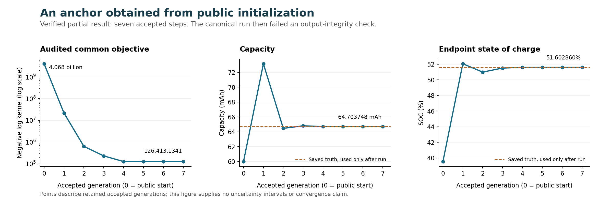

# Autonomous anchors: verified partial progress from a failed invocation

## Outcome and qualification

Starting from the fixed public entering mean, the host refiner obtained an anchor with **capacity 0.06470374762381097 Ah** and **current SOC 0.5160286018382255** after **seven accepted joint steps**. It used neither the historical fitted anchor nor truth during inference. The separately reviewed post-run comparison gives errors of **+0.00579231% capacity** and **−0.00242428 SOC percentage points**. This is useful evidence that the earlier supplied anchor can be approached through internally generated refinement on this prefix.

**The original invocation remains failed.** A previously bound raw output capture became empty during the run. The supervisor detected the changed file and stopped before the complete backtracking/stopping sequence finished. A separately frozen, read-only failure analysis verifies the seven accepted generations and reports their partial evidence; it does not turn the failed invocation into a successful completed experiment. See the [original result](attempt001/result.json), [outer failure receipt](execution_process/receipt.json), [qualified failure summary](failure_reporting001/summary.json), [reporting receipt](failure_reporting001/receipt.json), and [independent result review](result_review.json).

## Fixed problem and refinement method

The [contract](../../plans/autonomous_anchor_refinement_001.json) fixed one 252,000-observation prefix ending at 7,200 seconds. The unchanged nonlinear model, 0.001 V noise SD, full sixteen-coordinate entering chart, physical support and public two-component prior were retained. Initial values were exactly `PUBLIC_MEAN`; fitted vectors, recursive posterior centers, historical result summaries and truth were excluded from inference inputs.

The prior is the same coherent reference used for the preceding replacement test: the mixture of the two public Gaussian kernels, conditioned **as a whole** on the entering box and SOC feasibility throughout this input prefix. Density remains relative to the original entering-coordinate measure. Its common support normalizer cancels in objective differences. This reference is not asserted to reproduce the original online initialization's exact probability semantics.

At each accepted anchor, the C evaluator supplies the nonlinear likelihood cost, full gradient and full joint Gauss–Newton matrix. The exact mixture-prior gradient is added once. The proposal metric is

\[
g=\nabla L+\nabla p,\qquad B=G+P^{-1},
\]

where the common component precision bounds the mixture-prior Hessian above. This makes `B` an optimization metric and prior-curvature majorizer; it is not the exact nonlinear Hessian or posterior precision. The [proposal code](anchor_math.py) solves a constrained quadratic within the original support and a one-public-SD step box, using all sixteen coupled coordinates. It preserves the `H*h0` dependency and propagates each candidate's entering state through the complete ordered prefix.

A proposal must have raw physical feasibility and resolved directional/model decrease. The parent then tests the fixed fractions `1, 1/2, …, 1/128` against the actual nonlinear likelihood plus the exact mixture penalty. Acceptance requires the quarter-slope Armijo decrease **and** the frozen arithmetic-resolution account. The full-step point is used exactly as returned; partial chords are checked again without clipping. No voltage-error cutoff or truth-derived threshold is involved. [Worker](proposal_worker.py) and [supervisor](../../tools/run_autonomous_anchor_refinement.py) separate proposal algebra from model calls and preserve their accounting.

Every accepted audit becomes the next anchor directly, without another pass merely to obtain derivatives. Its block replaces the preceding representation of observations **[0, 252000)**. The cursor stays at 252000, with one prior and one active likelihood block. Archived generations and rejected trials do not become additional evidence factors.

## Accepted public-start sequence

All seven installed updates were accepted at the full trial fraction. The computed common objective decreased at every installed generation. These are successive refinements of the **same** observation prefix, not successive times in the battery trajectory. Values below are rounded for display; the [qualified summary](failure_reporting001/summary.json) retains the complete values and source identities.

| Generation | Capacity, Ah | Current SOC, fraction | Computed common objective |
| --- | ---: | ---: | ---: |
| 0: public start | 0.060000000 | 0.395376984 | 4,068,160,781.516271 |
| 1 | 0.073160871 | 0.520636427 | 21,766,048.002587 |
| 2 | 0.064469771 | 0.509959679 | 637,043.779245 |
| 3 | 0.064808714 | 0.515121768 | 230,271.137494 |
| 4 | 0.064710458 | 0.516020923 | 126,661.038682 |
| 5 | 0.064703768 | 0.516029383 | 126,421.266471 |
| 6 | 0.064703747 | 0.516028622 | 126,413.147839 |
| 7: last installed | 0.064703748 | 0.516028602 | 126,413.134107 |

[SVG version](anchor_trajectory.svg). Reference/truth comparisons in the figure are post-run annotations, never initialization or acceptance inputs.

After the accepted-prefix review, the failure reporter read the immutable previous summary once and reused its already verified endpoint truth record. It opened no raw truth file and performed no model, optimizer or prior-function evaluation. The public start's endpoint errors were −7.26430% capacity and −12.06759 SOC points; generation 7 has the small errors stated above. Its computed common objective differs from the earlier supplied-anchor feasible point by **−4.4718e−8**. That descriptive difference does not establish a superior optimum or a numerically resolved improvement over that reference. The reference itself is a feasible point, not a global optimum. See the [separate reporting contract](../../plans/autonomous_anchor_failure_reporting_001.json) and [receipt](failure_reporting001/receipt.json).

## Solver status and the unfinished final search

The first six constrained-quadratic solves remain independently **KKT-unresolved**. Their directions were usable because the separate descent, feasibility and nonlinear acceptance checks passed. Proposal rounds 7 and 8 passed the independent quadratic KKT checks. A quadratic proposal's convergence does not establish stationarity of the complete nonlinear objective, even when the same point has a low observed cost.

Generation 6 to 7 reduced the computed common objective by **0.013731920091114347**, clearing its arithmetic allowance and Armijo requirement. Round 8 then proposed much smaller changes:

| Trial fraction | Computed objective decrease | Cost-resolution allowance | Recorded outcome |
| --- | ---: | ---: | --- |
| 1 | 2.1920272593e−6 | 5.6591799432e−5 | Rejected |
| 1/2 | 1.5831787810e−6 | 5.6591799423e−5 | Rejected |
| 1/4 | 9.1419922299e−7 | 5.6591799419e−5 | Child assessment completed; parent trial record not committed |

These are positive **computed** changes below the declared resolution account, so they were not accepted. They do not show worsening or prove that no better point exists. The original parent count remains **two recorded rejected trials**; the separately preserved third assessment is explicitly additional completed work. The capture-integrity failure prevented completion of the remaining fraction schedule. There is no successful normal stopping result to infer from this partial trace. All these distinctions are retained in the [qualified summary](failure_reporting001/summary.json).

## Capture loss and separate exact recovery

The problematic file was `attempt001/calls/call027_model/raw_probe.json`. It had been parsed, bound as **12,427 bytes**, and copied into the following assessment request. A later check found it empty. The original bound SHA-256 was `dda4e930bbc097082f4bff05800f227a4595a1616d3fe51345b8b1f0af76c6e2`.

The [failure diagnostic](failure_diagnostic.json) reconstructed the exact original bytes from the preserved parsed payload and deterministic serialization. The [separate recovery](recovery001/call027_raw_probe.json) matches that original byte count and hash. Independent review reproduced the recovery and verified the accepted prefix before permitting the failure report.

The original empty file, failed receipts and frozen inference sources remain unchanged. Recovery did not resume inference, install another generation or reclassify the failure. The capture-loss cause remains **unattributed**: source review found unique per-call capture directories and no identified path that rewrites an earlier capture, but no syscall trace identifies the responsible process or service. This is an evidence-preservation failure, not evidence that the battery model or the rejected trial was numerically invalid.

## Work and resource limits

The failed invocation completed **11 full-prefix model passes**, **2,772,000 model steps**, **eight proposal solves**, **578 counted quadratic objective/gradient evaluations**, and **11 external exact-prior evaluations**. There were seven installed replacements, two recorded rejections and no recorded infeasible trials. Inference read no historical candidate or truth, invoked no learner or original fitter, generated no new source data and made no retry.

The [whole-process receipt](execution_process/receipt.json) records **28.310357 CPU seconds**, **29.060402365998016 active wall seconds**, maximum `wait4` peak RSS **63,991,808 bytes**, and **2,278,422 bytes** of closed runtime output. Recorded resources were within the frozen limits; the invocation nevertheless failed its integrity check. RSS is a process high-water statistic, not summed simultaneous memory. Recovery and post-failure reporting are separate activities.

The C evaluator still requires **10,680 bytes of fixed workspace** within an **11,072-byte compiler-reported main frame**, plus an essential **8,064,000-byte external prefix**. Workspace and main-frame figures overlap and must not be added as disjoint storage. Either already exceeds a 10,240-byte total subsystem budget before other runtime, solver and stack costs. Production estimator code is unchanged; this host result does not qualify Cortex-M23 resources.

## Decision and bounded next work

Retain the verified public-start sequence as useful **partial evidence**. It shows substantial internally generated movement toward a useful anchor in this one case. Preserve the failed invocation and unfinished stop. There is no global-MAP, completed-refinement, posterior-interval, calibrated-coverage or firmware claim, and the candidate is not promoted.

The immediate engineering task is a finite capture-preservation qualification using fabricated children and deliberate truncation/duplicate-writer cases. Give each launched child exclusive capture ownership, save an independent exact snapshot with its hash before dependent work, and verify in the fabricated cases that later mutation is detected and preserved as a failure. An extra copy improves recoverability without proving that the underlying storage cannot mutate. Finish with a reviewed lifecycle/manifest contract; do not replay this inference to erase its failure.

If further point progress requires distinguishing the late tiny changes, design a separate paired-cost comparator that accumulates residual differences directly, with source-derived arithmetic bounds. It should avoid subtracting two large accumulated costs without lowering the old guard or inventing a voltage floor. Such a comparator must be qualified before any new inference contract. Joint posterior and interval fidelity remain a separate question: obtaining a useful center does not determine how much supported probability lies away from it. No additional scientific execution or longer campaign is initiated by this [decision](decision.json).
