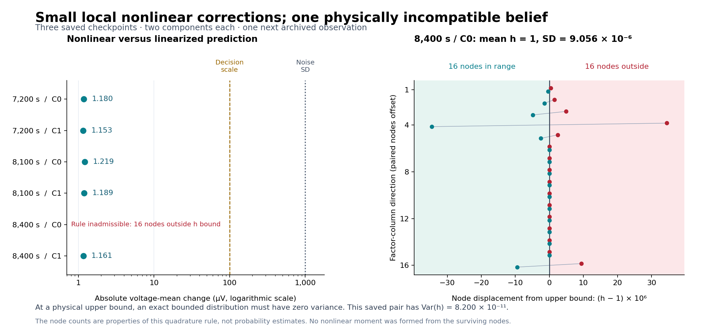

# Conditional-belief adequacy probe 001

## Decision

**The specified three-checkpoint probe completed once. It confirms a physical
moment inconsistency in one saved component and finds small immediate nonlinear
voltage-moment changes in the other five component snapshots.** Close this probe
and prioritize a joint, support-consistent conditional-uncertainty design.

The result narrows the investigation but does not explain all SOC/capacity
undercoverage or establish the cause of the earlier 7,811-second weight switch.
The existing candidate remains retained for investigation and unpromoted.

At 8,400 seconds, component 0 has a hysteresis mean exactly at its upper bound,
`h=1`, with positive variance. Those cannot be the moments of any distribution
confined to the physical interval `[-1,1]`. Sixteen of the prescribed 32 nodes
are outside that interval. In the five complete admitted node sets, the largest
voltage-mean change is **1.218768 microvolts**, against declared observation-noise
SD **1,000 microvolts**. The largest variance change is **1.231390e-11 V²**,
against observation-noise variance **1e-6 V²**.

Sources: [frozen contract](../../plans/conditional_belief_adequacy_001.json),
[raw probe](attempt001/raw_probe.json), [canonical reduction](attempt001/result.json),
[execution receipt](attempt001/receipt.json), [independent result review](result_review.json),
[summary](summary.json), and [continuation decision](decision.json).

## What ran

The probe restored the existing Cell B checkpoints at **7,200, 8,100 and 8,400
seconds**, indices 252000, 283500 and 294000. For each checkpoint it read exactly
the next archived observation, with the original dt and current. A checkpoint
with `next_index=n` has already consumed observations 0 through n-1; this probe
uses observation n and forecasts endpoint n+1.

The next currents are respectively **+60 mA discharge, zero current, and
−60 mA charge**. This matters at the selected phase boundaries: reusing the
checkpoint's previous current or stored previous innovation would answer a
different question. None of these checkpoints is the exact 7,811.171429-second
dominance-switch state.

For each of the two sixteen-dimensional components, the saved covariance is
`P=L Lᵀ`. The rule uses the 32 equal-weight points

\[
x_{k,\pm}=\mu\pm4L_{:,k},\qquad w_{k,\pm}=1/32.
\]

Every point is checked against all public coordinate bounds before propagation.
Each admitted point advances through the unchanged physical model once and
receives complete post-propagation domain checks. Any failed point makes that
component's complete moment rule unavailable. The probe retains individual
records but never forms a moment from a surviving subset.

The comparison reference uses the full covariance and cross-covariances:

\[
\mu^-=f(\mu,u),\quad B=F(\mu,u)L,\quad
g=\nabla h(\mu^-,u),\quad
\bar V_{\rm lin}=h(\mu^-,u),\quad
S_{\rm lin}=\|gB\|^2+\sigma_V^2.
\]

The nonlinear rule uses the population variance of all 32 admitted voltage
values and adds the same fixed observation-noise variance once. There is no
voltage correction, learner update, weight update, new generated trajectory or
truth input. The design is a finite diagnostic of the retained Gaussian;
spherical-radial quadrature does not recover an exact nonlinear posterior.

## The six comparisons

The table reports nonlinear minus linearized moments. Each successful complete
rule uses all 32 points.

| Saved time | Component | Admitted points | Mean change, µV | Variance change, V² | Outcome |
| --- | --- | ---: | ---: | ---: | --- |
| 7,200 s | 0 | 32/32 | −1.179519 | +1.231390e-11 | Below both frozen scales |
| 7,200 s | 1 | 32/32 | −1.153171 | +9.063332e-12 | Below both frozen scales |
| 8,100 s | 0 | 32/32 | +1.218768 | +1.129694e-11 | Below both frozen scales |
| 8,100 s | 1 | 32/32 | +1.188904 | +9.159789e-12 | Below both frozen scales |
| 8,400 s | 0 | 16/32 | Unavailable | Unavailable | Sixteen pre-propagation h-bound violations |
| 8,400 s | 1 | 32/32 | +1.161016 | +8.233016e-12 | Below both frozen scales |

The predeclared decision scales were **0.1 σV = 100 µV** for mean change and
**0.1 σV² = 1e-7 V²** for variance change. The largest observed admitted mean
shift is **0.001218768 σV**, and the largest variance shift is
**1.231390e-5 σV²**. These scales prioritize a mechanism; they are not coverage
tests, mathematical approximation-error bounds, or bounds on accumulated
likelihood effects.

The five admitted results therefore deprioritize replacing the immediate
one-step moment formula at these particular states and scales. They leave open
errors accumulated earlier, when the beliefs may have been broader or differently
placed, and accumulated effects of small sequential score differences.

The right panel displays the prescribed h-coordinate displacements at the
failing snapshot. Paired markers are slightly offset vertically for visibility.
Sixteen failed nodes out of 32 are a property of this quadrature rule; that
fraction is not a Gaussian tail-probability estimate.

## The boundary finding is stronger than a Gaussian-tail observation

Any scalar random variable X confined to `[a,b]` must satisfy

\[
\operatorname{Var}(X)\le(b-\mathbb E[X])(\mathbb E[X]-a).
\]

This follows because `(X-a)(b-X)` is nonnegative throughout the interval. Taking
its expectation and expanding gives the bound. It is necessary for every
bounded distribution, regardless of Gaussianity.

For h in `[-1,1]`, the right side is `1−μh²`. The saved 8,400-second component 0
has:

| Quantity | Recorded value |
| --- | ---: |
| Mean h | 1 exactly |
| SD(h) | 9.055643565861842e-6 |
| Var(h) | 8.200468039193499e-11 |
| Maximum variance compatible with that mean and support | 0 |
| Frozen arithmetic comparison allowance | 1.1368683772161603e-13 |
| Excess divided by the allowance | 721.320797 |

The positive variance is well beyond the numerical comparison allowance. An
uncertain physical h distribution must place some mass below 1; its physical
mean must then also be below 1. Keeping the mean exactly at 1 while retaining
positive variance cannot describe such a distribution.

All **96 saved scalar mean/variance pairs** were checked; this is the only
violation. Passing the other scalar checks is necessary but insufficient for a
valid joint bounded distribution, and does not establish uncertainty coverage.

This is a representation/constraint inconsistency under a bounded-physical-
belief interpretation. The current API explicitly labels its outputs as local
Gaussian diagnostics, and the result does not establish a new arithmetic bug.
It shows why those diagnostics cannot be treated as a physical uncertainty
distribution without a stronger representation and update contract.

The failing component is already overwhelmingly downweighted at 8,400 seconds:
its saved log weight is **−58,706.554482**, while component 1's is zero to the
recorded precision. The boundary finding is later than the 7,811-second switch
and belongs to the alternative component at this checkpoint. It cannot be used
to claim that this boundary contact caused the earlier switch or explains all
aggregate SOC/capacity interval failures.

## What the source explains, and what remains a hypothesis

The [source review](source_review.json) traces the unchanged
[conditional learner](../../src/scm_hypothesis.c). Physical bounds constrain
the mean, while the covariance remains a local Gaussian moment approximation.
The selected coordinate gains are used consistently in the full Joseph
covariance update; the problem is not a mean update paired with an unrelated
unlimited covariance update.

Write `g=P⁻H/√S` for the normalized optimal gain and `tᵢ=λᵢgᵢ`, with
`0≤λᵢ≤1`, for the actual selected gain. The implemented Joseph update implies

\[
P^+=P^- -gg^T+(g-t)(g-t)^T,
\qquad
P^+_{ii}=P^-_{ii}-\lambda_i(2-\lambda_i)g_i^2.
\]

Thus each correction marginal variance is nonincreasing in real arithmetic.
For the static parameter coordinates, prediction leaves the corresponding
factor rows unchanged and introduces no process covariance. Their marginal
variances consequently cannot grow during ordinary prediction/correction.
A blocked coordinate retains its predicted marginal variance; blocking alone
does not apply the unlimited covariance contraction to that coordinate.

This is a property of the implemented local conditioning model, not proof that
variance contraction itself is erroneous. It becomes relevant because earlier
observations survive only through the evolving means and factors. Their
nonlinear likelihood contributions are not retained for reevaluation when the
parameter estimate moves. Computing better one-step moments from that same Gaussian does not reconstruct
the earlier nonlinear likelihood. New data can still move the estimate, but
this calculation alone provides no mechanism for recovering uncertainty omitted
by the historical summary.

The completed probe supports that distinction: present local nonlinear moment
changes are small where evaluable, while physical compatibility fails in one
retained belief. The evidence still does not identify when or through which
specific historical approximation the SOC/Q uncertainty became unreliable.

## One concrete next decision

The next finite task is a **joint support-consistent conditional-correction
design decision**, with an analytically solvable single-active-h-bound reference.
The question is whether physical support, the voltage evidence, and all joint
state/parameter dependencies can be represented coherently within the intended
storage and computation budget.

For a Gaussian voltage update with moments `(mG,PG)`, conditioning on a single
h bound has a useful joint reference. If `mT,vT` are the correctly truncated h
moments and `b=PG[:,h]/PG[h,h]`, its joint moment equations are

\[
m_{\rm new}=m_G+b(m_T-m_{G,h}),\qquad
P_{\rm new}=P_G+bb^T(v_T-P_{G,hh}).
\]

These equations explain the required joint behavior: changes to physical h
moments also affect correlated SOC, log-capacity and other coordinates. They
are an analytic reference for the next design, not a correction applied to the
saved checkpoints. The zero-variance case, complete box support, prediction
representation, and support/likelihood normalization require explicit treatment.
Support and voltage evidence must enter once; projecting a Gaussian repeatedly
without tracking what has already been conditioned on is not a complete contract.

The design finish line is one reviewed go/no-go decision, equations, a complete
state/workspace account, and three fixed cases for subsequent qualification:
an interior linear case, an outward h-bound case with SOC/logQ correlations,
and a zero-information case preserving an already supported belief. It must
not create certainty by simply zeroing the h covariance, silently clip moments,
lose joint dependence, or claim to recover discarded historical uncertainty.
No new trajectory, estimator replacement, coverage claim or weight change is
implied. See [decision.json](decision.json).

## Verification, resources and provenance

The canonical probe used **176 node propagations plus six centers**. The sixteen
invalid pre-domain nodes were recorded without physical propagation. All **4,056
canonical reconstruction checks** passed. Independent review made **6,003
algebra, identity and accounting checks** without another model evaluation or
probe/reducer run; it found no mismatch.

The review reconstructed all 192 intended nodes, 816 lower-triangle chart
covariance entries, 96 bounded scalar pairs, and the five complete voltage
moment sets. All 26 bound file identities remained unchanged, and the four
closed output files account for exactly **279,424 bytes**.

| Resource | Recorded value | Scope |
| --- | ---: | --- |
| Probe wall time through wait4 | 0.014307688 s | Exact child |
| Probe user + system CPU | 0.013121 s | Exact child |
| Probe peak RSS | 10,039,296 bytes | Includes fork/exec setup; excludes git/compiler children |
| Supervisor peak RSS | 15,896,576 bytes | Its own process, sampled after reduction and input posthash |
| Supervisor wall before receipt | 0.391455182 s | Validation, capture, reduction and posthash |
| Canonical closed derived outputs | 279,424 bytes | Raw JSON, stderr, reduction and receipt |
| Selected archived inputs restored | 16,137,012 bytes | Three checkpoints and original observation member |

The exact source authority is `b0be4adeedc26dc3617f32282ff4c949635757fa`,
tree `0c2436e23591a5d5d2d1963005378f00732ebb06`. The published contract authority
is `7ee11761abbc0990ea44df265b60004f63481565`; its identical local freeze
`1dd77689f27a9a17ce01bd08d36313651149428a` preceded restoration. The contract
SHA-256 is `49ebd3fb609f9fa739076c14979265a7b50e93025c3692999a6b6747e9c9778e`.
The qualified executable SHA-256 is
`80ebc729d651639f9b2e541dc68f3de618e52fc29f4ad82b24b383a691d3ce1d`.

The [executable receipt](executable_receipt.json),
[implementation review](implementation_review.json),
[restoration receipt](restoration.json) and separate fabricated-qualification
records preserve the preparation history. Report rendering is a read-only
reduction of the completed artifacts and makes no physical-model calls.

No production source, estimator SRAM, original experiment or prior audit was
changed. The earlier continuous-study supervisor RSS gap remains a historical
limitation; this probe's explicit measurements do not repair it. Calibrated
uncertainty, complete Cortex-M23 resources, and indefinite-operation behavior
remain open obligations.
