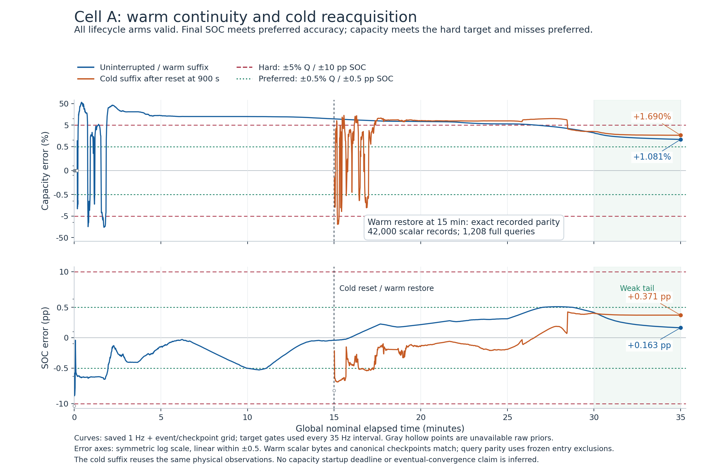
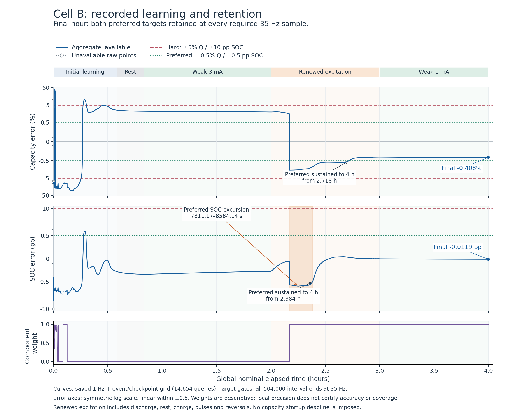

# Continuous learning validation 001 — implementation and outcome

## Outcome

The unchanged public-split learner completed the frozen lifecycle and continuous experiment once. Cell B finished its four-hour stream with **−0.408454% capacity error** and **−0.0118574 SOC percentage points**, inside both preferred targets. At the start of the final weak-use hour and all **126,000** subsequent interval ends, both preferred targets remained satisfied.

The result also contains a specific accuracy regression. Previously preferred SOC accuracy was lost during renewed excitation for **772.971429 seconds**, then recovered. Cell A finished inside the hard capacity target but outside the preferred capacity target. Local uncertainty remains unreliable as an accuracy guarantee. The candidate is **retained for a bounded follow-up diagnosis and is not promoted**.

The [compact result](summary.json), [decision](decision.json), [independent interpretation review](interpretation_review.json) and [independent validity/resource review](independent_run_review.json) preserve these distinctions. The original [design](../REPORT.md) and [contract](../../../plans/continuous_learning_validation_001.json) remain unchanged.

## What was executed

The seven pinned estimator source files were unchanged. New host code supplied an independent stateful synthetic source, a truth-free C adapter, a separate post-inference scorer, and a supervisor. Physical state, event position, scalar RNG state, charge, complete learner components/factors, evolving log weights and all cursors carry through the declared chronology. There is no forgetting, pruning, process-noise change, reseeding, truth initialization or runtime oracle selection.

The source implementation was published as `f73f39f276b84bcb76be8d5dc177c55191d34ff1`. The executable receipt and its independent review were published as authority commit `dd877e717b143a859bef8d119e6ddd40bf454012` before primary data generation. See [source publication](source_publication.json), [executable receipt](executable_receipt.json) and [executable review](executable_review.json).

Qualification used **928 learner deliveries out of 4,096**, with 833 toy source draws and zero primary draws. It includes the adapter interfaces and signal stops, generator continuation and safe-boundary signals, fabricated scorer cases, fresh-process coupled restores at an interior event and transition, and cold-reset semantics. The final metadata-only correction added no learner deliveries or draws. Original checks and review findings are retained in [preflight](preflight.json) and `development/`.

| Primary arm | Source interval | Learner deliveries | Saved full queries | Result |
| --- | --- | ---: | ---: | --- |
| A uninterrupted | 0–2,100 s | 73,500 | 2,267 | Valid |
| A warm suffix | 900–2,100 s | 42,000 | 1,208 | Valid; exact continuation |
| A cold suffix | 900–2,100 s | 42,000 | 1,208 | Valid public reset on original physical suffix |
| B continuous | 0–14,400 s | 504,000 | 14,654 | Valid; no reset |
| **Total** | | **661,500** | **19,337** | **Zero rejected updates** |

There were 577,500 unique physical observations and 619,500 generator evaluations including the deliberately regenerated 42,000-record warm suffix. The cold arm reused the original observations. There were exactly four learner processes, three source helpers and one scorer helper. All-sample target scores use every 35 Hz interval; full vectors, local ranges and plots use the frozen 1 Hz plus boundary/checkpoint grid. See the [primary receipt](primary/receipt.json) and [scoring results](primary/scoring/scores.json).

## Cell A: lifecycle success, preferred capacity still unresolved

The warm suffix matches the uninterrupted run in all 42,000 scalar records, the regenerated observation bytes, 1,208 full query records under the frozen entry exclusions, canonical learner checkpoints and complete source/RNG state. The cold suffix restores the public prior once, retains the global cursor, marks lost history and continues the original plant/noise suffix. A's numerical, accounting, lifecycle and known owned-resource gate passed; its accuracy was observational for admission to B.

| Arm at 2,100 s | Capacity estimate | Capacity error | SOC error | Endpoint target result |
| --- | ---: | ---: | ---: | --- |
| Uninterrupted | 0.0606488061 Ah | +1.081343% | +0.163462 pp | Q hard; SOC preferred |
| Warm suffix | 0.0606488061 Ah | +1.081343% | +0.163462 pp | Identical to uninterrupted |
| Cold suffix | 0.0610141826 Ah | +1.690304% | +0.371131 pp | Q hard; SOC preferred |

The 1,800–2,100 s weak tails retain hard capacity and preferred SOC accuracy. Preferred capacity is classified **not acquired at entry**, and remains outside target at the endpoint. These are finite observations, with no capacity startup deadline and no claim of eventual failure. Warm and cold suffixes are lifecycle comparisons on shared physical observations, not independent noise replications. Sources: [A baseline](primary/scoring/A_uninterrupted.json), [warm](primary/scoring/A_warm_suffix.json), [cold](primary/scoring/A_cold_suffix.json), [parity](primary/A_warm_suffix/parity.json).

## Cell B: acquisition and retention

Hard targets are capacity error at most 5% relative and SOC error at most 10 percentage points. Preferred targets are 0.5% capacity and 0.5 SOC percentage points. Errors below are estimate minus truth. At the public entry, availability is false; a raw prior value is not a useful attained target.

A first favorable sample is different from accuracy that remains inside target through a finite endpoint. The early capacity preferred hit at 23.8 s did not establish lasting accuracy. Capacity was unavailable for the first 350 intervals (10 s). SOC was available after each delivered interval, and its largest observed absolute point error was 4.721520 pp, inside the hard limit.

| Quantity / target | First available hit | Start of continuous attainment through 14,400 s |
| --- | ---: | ---: |
| SOC hard | 0.028571 s | 0.028571 s |
| Capacity hard | 22.314286 s | 1,096.628571 s |
| SOC preferred | 2.657143 s | 8,584.142857 s |
| Capacity preferred | 23.800000 s | 9,784.800000 s |

SOC preferred had already been sustained from 1,080.914286 s through the initial 2,100 s acquisition endpoint, and was then retained through 7,200 s. The later start shown in the table reflects the real renewed-use regression. All times are nominal source times, resolved to one 35 Hz interval; actual accumulated binary64 clocks are preserved separately. Sources: [B whole-arm and window scores](primary/scoring/B_continuous.json).

| B phase | Entry → exit capacity error | Entry → exit SOC error | What the saved evidence supports |
| --- | ---: | ---: | --- |
| Initial acquisition, 0–2,100 s | Raw prior −7.2643% → +2.5429% | Raw prior −10.0000 pp → −0.2770 pp | Hard Q and preferred SOC attained by endpoint; no capacity deadline |
| Rest + weak use, 2,100–7,200 s | +2.5429% → +1.9749% | −0.2770 pp → −0.2730 pp | Q hard and SOC preferred retained at entry and all 178,500 intervals; Q preferred not acquired at entry |
| Renewed use, 7,200–10,800 s | +1.9749% → −0.4235% | −0.2730 pp → −0.0030 pp | Q reaches sustained preferred; SOC temporarily leaves preferred; both remain inside hard limits |
| Final weak use, 10,800–14,400 s | −0.4235% → −0.4085% | −0.0030 pp → −0.0119 pp | Both preferred targets retained at entry and all 126,000 intervals |

In the final hour the maximum absolute capacity error is **0.423702%**, and the maximum absolute SOC error is **0.0118574 pp**. SOC's small increase from approximately 0.0030 to 0.0119 pp remains wholly within the preferred region and is successful retention. No further improvement is required to call that window successful.

The figure shows saved full-query points; all target assertions use the denser 35 Hz scalar evidence. Its error axes use a symmetric log scale outside ±0.5, so early large errors and later preferred-region behavior remain visible. A single prescribed chronology does not isolate elapsed time from excitation as a causal explanation.

## The specific regression and the next diagnostic question

The first renewed-use SOC preferred failure is **index 273391 at 7,811.171429 s**. SOC is outside ±0.5 pp for **27,054 consecutive intervals**, returning inside at **index 300445, 8,584.142857 s**. The peak absolute error is **0.808669 pp** at 8,100.057143 s. The crossing rows remain available with return code zero and no failure flags. This is an accuracy regression, not an unavailable estimate or a numerical transaction failure.

The saved component/weight evidence identifies an output-weighting symptom. At the 7,811 s full query, component 0 has SOC error about −0.054489 pp and component 1 about −0.688081 pp; log weights are approximately −0.000291 and −8.141936. At 7,812 s, component 1 dominates, the aggregate SOC error is about −0.688545 pp, and component 0 still has about −0.054490 pp error. At 8,400 s, component 0 passes both preferred targets (SOC −0.393306 pp; Q −0.153510%), while the aggregate misses both (SOC −0.760008 pp; Q −1.469287%).

This motivates a **bounded diagnosis of the component evidence and output weighting around the switch**, starting with the preserved outputs and checkpoints. It does not authorize selecting a truth oracle, pruning components, tuning weights from truth, or attributing a unique causal mechanism from this chronology. It also does not justify a longer run as an automatic remedy. The [interpretation review](interpretation_review.json) records exact crossing rows and saved-query evidence.

## Voltage and all sixteen coordinates

The causal voltage forecast uses pre-update weights and pre-correction component innovations, and is logged after the transaction. It is distinct from the query's post-correction fitted voltage. For B, causal forecast error against clean voltage has **1.044500 mV RMS** over the whole stream, including an initial 102.772407 mV absolute error from the public start. During the final weak hour, causal clean-voltage RMS is **0.246605 mV**, maximum **0.927719 mV**. Noisy innovation and post-correction clean-voltage residuals have separate reducers in the saved scores; a fitted residual is not presented as forecast performance.

The final aggregate natural-unit vector is shown below. These point errors do not impose nuisance-parameter precision requirements or establish identifiability. Complete aggregate/component vectors, coordinate SDs and saved-grid errors are retained in the [reporting extraction](reporting/observed_results.json) and archived full-score rows.

| Coordinate | Truth | Aggregate estimate | Signed error |
| --- | ---: | ---: | ---: |
| tau1_s | 0.075 | 0.0914707705 | +0.0164707705 |
| tau2_s | 0.65 | 0.764912305 | +0.114912305 |
| tau3_s | 7.5 | 8.0958503 | +0.595850296 |
| gamma_plus_per_Ah | 330 | 332.408273 | +2.40827287 |
| gamma_minus_per_Ah | 500 | 503.961903 | +3.96190344 |
| Q_Ah | 0.0647 | 0.0644357304 | -0.000264269635 |
| R0_ohm | 0.16 | 0.17594178 | +0.0159417797 |
| R1_ohm | 0.22 | 0.229453826 | +0.00945382594 |
| R2_ohm | 0.27 | 0.261583077 | -0.00841692321 |
| R3_ohm | 0.33 | 0.321474156 | -0.00852584373 |
| H_V | 0.03 | 0.0288392204 | -0.00116077959 |
| SOC | 0.423317141 | 0.423198567 | -0.000118574018 |
| v1_V | 0.00022 | 0.000229453826 | +9.45382594e-06 |
| v2_V | 0.00027 | 0.000261583077 | -8.41692321e-06 |
| v3_V | 0.00033 | 0.000321474156 | -8.52584373e-06 |
| h | 0.214214301 | 0.216194797 | +0.00198049594 |

## Uncertainty remains a separate unresolved obligation

Accurate final points do not repair the reported local ranges. The descriptive B audit is:

| Reported range | SOC truth inclusion | Capacity truth inclusion |
| --- | ---: | ---: |
| Aggregate local interval | 119 / 14,653 (0.8121%) | 231 / 14,653 (1.5765%) |
| All-component hull | 1,793 / 14,654 (12.2356%) | 13,449 / 14,654 (91.7770%) |

These are inclusion frequencies on one correlated serial saved grid, not calibrated coverage probabilities. There are **906** saved aggregate local-provisional capacity queries with a hard point-error breach. At the final point, both aggregate local intervals exclude truth. The all-component hull includes final capacity truth but still excludes SOC truth.

For example, final Q truth is 0.0647 Ah, while the aggregate local interval is approximately [0.064433719, 0.064437742] Ah. Final SOC truth is 0.423317141, while its aggregate local interval is approximately [0.423194111, 0.423203024]. Application accuracy remains unresolved and no hard physical support is supplied. The corresponding A local intervals also have numerous truth misses; all original uncertainty failures remain preserved. Source: [B full-query uncertainty audit](primary/scoring/B_continuous.json).

## Runtime resources and the measurement limit

The primary processing took **17.2194 s** and the one scorer helper **33.9928 s**; elapsed primary plus scoring was **51.2299 s**. The closed primary directory contains **391,584,188 bytes**, below 536,870,912 bytes (512 MiB). The completion receipt reports 391,583,956 bytes before writing its own 232-byte file; the independent audit accounts for that difference. The largest saved full query is 6,465 bytes, below 8,192, and the full-query total is below the 24,000 cap.

Recorded worker `wait4` RSS high-water marks peak at **33,976,320 bytes**, below the 512 MiB worker limit. **The supervisor's own RSS high-water mark was not saved**, so this study does not fully verify the all-process memory ceiling. Near-zero sampled RSS values are not evidence of zero usage. The [resource review](independent_run_review.json) reports this gap explicitly; a future supervisor revision should record its own high-water measurement before another resource qualification.

The unchanged estimator's owned subtotal is **7,152 bytes**. The proposed complete target allocation of 10,032 bytes includes 2,880 bytes of unmeasured reserves and leaves 208 bytes under 10,240. This run adds host observation, checkpointing, Python and supervisor resources; those are not reported as embedded estimator storage. Complete Cortex-M23 SRAM, software-math/stack, timing, persistence and indefinite-operation qualification remain open.

## Preservation and decision

The original primary and its single scorer output remain immutable. Small receipts and scored summaries are published directly; all original runtime artifacts are preserved losslessly in the [indexed evidence archive](evidence/README.md), including source journals, full queries, all 35 Hz scalar records and canonical checkpoints. Archive creation and plot layout are delivery operations after the experiment; they do not regenerate source data, rerun a learner or rerun the scorer.

The finite decision is to **retain this candidate without promotion**, preserve the successful final retention and the genuine preferred-SOC regression, and close this experiment. The next question is the bounded weighting/output episode, alongside honest uncertainty reporting and the supervisor memory measurement correction. No seed, horizon, component-count or duration sweep is queued. No day/week/annual campaign or target qualification follows automatically from these results.
