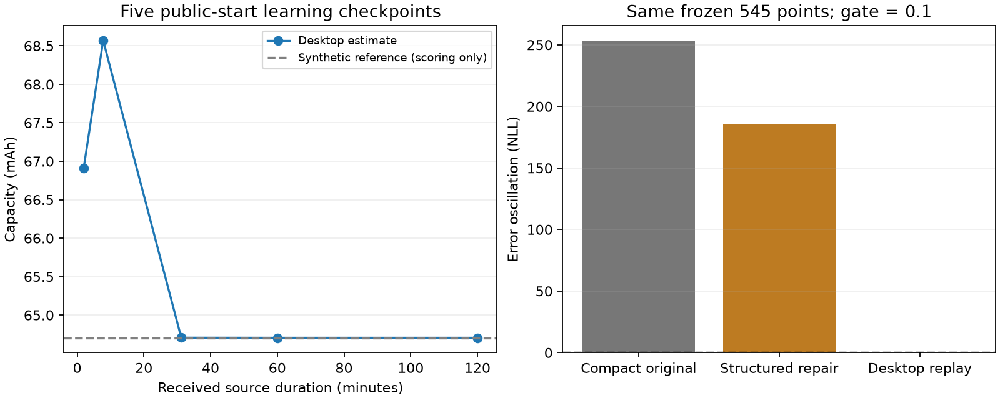

# Desktop retained-history baseline

**The desktop baseline passes the existing history-fidelity test and completes
a separate public-start learning run.** It keeps all observations received so
far and evaluates the original recurrence afresh at each query. This removes
the compact history approximation from the objective; it does not meet the
10 KiB deployment target.

The user explicitly authorized extra desktop memory before returning to the
deployable design. This changes the experimental resource boundary, while
preserving the old failed compact candidates and their evidence.

| Check | Result |
|---|---:|
| Fabricated qualification | 78 checks passed |
| Frozen reference comparison | 545 / 545 available |
| Centered likelihood-error oscillation | 0 NLL |
| Computed-arithmetic interval | [0, 0.000276671] NLL |
| Unchanged fidelity gate | 0.1 NLL |
| Maximum endpoint difference from saved reference | 0 |
| Received observations in learning run | 252,000, about two hours |
| Decoded history allocation | 6,048,000 bytes |
| Maximum worker process RSS | 54,108,160 bytes |
| Five-checkpoint learning CPU / wall time | 8.03743 / 8.09955 seconds |

See the [registered plan](plan.json), [qualification](qualification/development001/receipt.json),
[execution receipt](attempt001/receipt.json), [saved-result review](result_review.json)
and [decision](decision.json). Review is by the implementation agent, not an
independent reviewer.



## What the baseline does

[replay.c](replay.c) evaluates the likelihood, its original-coordinate gradient,
and the Gauss–Newton metric from ordered decoded samples. Each evaluation starts
from the candidate's entering state and carries physical state continuously
through the entire received prefix. It retains actual intervals and source order.
There is no old polynomial factor or approximate boundary transport.

[desktop.py](desktop.py) retains the original public support and the normalized
two-component capacity prior. The prior is included once per objective.
Repeated evaluations of observations do not accumulate additional evidence;
no posterior from an earlier prefix is added to those observations.

The optimizer starts at the public mean, then warms each checkpoint only from
the preceding accepted estimate. It uses damped Gauss–Newton steps, box
projection and exact-objective backtracking. Invalid SOC paths reject. Its
positive prior majorizer is a solver metric, not calibrated posterior precision.
The iteration cap, gradient tolerance and line-search policy were fixed before
execution. The source was committed and published as
[`1012981`](https://github.com/tumblewhead/mumble/commit/101298128923ae6123164e9265b658f553052835).

The fidelity and learning workers are separate. Only the fidelity worker loads
the existing frozen nodes and reference values. The learning worker reads one
new prefix increment at a time and loads no saved anchors, references or truth.
It performs no new source generation.

The 545-point comparison shares the original numerical recurrence with its
saved reference. Its exact agreement verifies integration and history handling,
not independent correctness of the physical model. Fabricated qualification
separately compares cost, all 16 gradients, the metric and carried endpoints
against an independent physical-state recurrence and automatic differentiation.

## Learning results and explicit solver stops

| Prefix | Approximate minutes | Capacity, mAh | Stop |
|---|---:|---:|---|
| 4,096 | 1.95 | 66.91317 | No further decreasing step |
| 16,384 | 7.80 | 68.57001 | Projected gradient below 1e-4 |
| 65,536 | 31.21 | 64.70535 | Projected gradient below 1e-4 |
| 126,000 | 60 | 64.70423 | No further decreasing step |
| 252,000 | 120 | 64.70429 | Projected gradient below 1e-4 |

Every accepted step decreases the exact objective for that prefix. The two
line-search stops retain projected-gradient magnitudes 0.00015944 and
0.00026113. They are not relabeled as tolerance passes. The final magnitude is
0.00004332. No global optimum, all-parameter convergence or validated coverage
is claimed. Early capacity estimates remain provisional; a small gradient alone
does not establish physical identifiability.

Only after the workers closed and output hashes were fixed, the reporting step
read existing published synthetic reference values to score the final estimate:

| Same two-hour prefix | Capacity error | Current SOC error, percentage points |
|---|---:|---:|
| Original compact learner | −0.173649% | −0.125185 |
| Desktop retained-history learner | +0.006627% | −0.002784 |

The desktop endpoint is 64.7042875 mAh and 51.6025003% SOC. The comparison changes
both representation and optimizer/update cadence; it cannot isolate their
individual contributions. It is one cell and one trajectory. Nuisance-parameter
errors remain, and the wider cell/load/noise/duration campaign has not started.

## Resources, provenance and next step

The history array costs 24 bytes per observation. It grows with duration; replay
work grows with the prefix and number of evaluations. Allocation, read/decode
transients, Python/NumPy and runtime workspace are reflected in measured process
RSS. This is neither bounded-memory firmware nor a 35 Hz latency demonstration.
The fidelity worker used 137,340,000 model steps and 18.0136 CPU seconds; the
learning worker used at most 58,059,904 steps and 1,163 evaluations, 184 with
derivatives. No compact estimator was silently expanded.

The original worker `source_revision` field mistakenly contains the experiment
base revision. The execution receipt and saved-result review correctly identify
the executed source as `1012981`; original worker records remain unchanged.
All source/input bindings and closed result hashes verified. The source remains
unchanged since qualification and execution.

Commands executed once:

```sh
python3 -B experiments/desktop_history_001/qualify.py experiments/desktop_history_001/qualification/development001
python3 -B experiments/desktop_history_001/run.py experiments/desktop_history_001/qualification/development001/receipt.json
python3 -B experiments/desktop_history_001/report_saved.py
```

Use this preserved desktop version as the comparison baseline for a bounded
history-refresh/compression experiment, especially across early estimate motion.
Measure approximation error, battery outputs, retained bytes and replay work
together. Allow diagnostic candidates more than 10 KiB while establishing what
information they need; then reduce storage toward the target. Do not fit
corrections to synthetic truth, change the 0.1 NLL criterion after results, or
silently forget observations. Useful uncertainty and broader trajectory stability
remain separate work before Cortex-M23 qualification.
