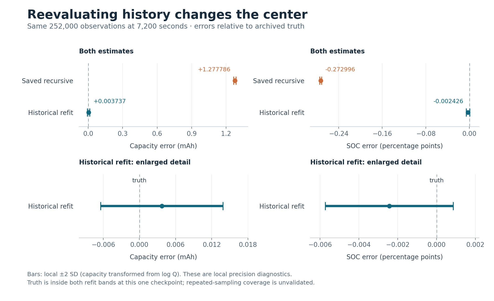

# SOC and capacity uncertainty: historical likelihood control

## Outcome and repair direction

**The historical fit recovers accurate target centers at the fixed checkpoint,
with almost the same capacity local precision as the recursive estimate.**
This is a concrete reason to repair the representation of accumulated nonlinear
evidence. A general uncertainty multiplier would leave the demonstrated center
error in place.

The completed control used the original 252,000 observations ending at 7,200
seconds. Its one free fit and two declared target-constrained fits completed
within their resource limits. No production estimator changed, and this result
does **not** yet solve calibrated interval reporting for the streaming learner.
The selected next step is a finite retained-likelihood replacement prototype,
with a common declared prior/support and complete joint dependencies.

The [summary](summary.json), [decision](decision.json),
[independent review](independent_review.json), [raw result](attempt002/result.json)
and [execution receipt](attempt002/receipt.json) retain the exact values and
qualifications. The [contract](../../plans/historical_likelihood_control_001.json)
was frozen before the fits; the input-only prelaunch repair is recorded below.

## What the same observations support

Truth was read from the original archive only after all three fit outputs,
receipts and bound input identities had been checked. The capacity truth is
64.700000 mAh and endpoint SOC truth is 51.6052844631%.

| Quantity at 7,200 s | Saved recursive aggregate | Free historical fit |
| --- | ---: | ---: |
| Capacity estimate, mAh | 65.9777862440 | 64.7037370130 |
| Capacity relative error | +1.97494010% | +0.00577591% |
| Capacity local SD, mAh | 0.00506324588 | 0.00507818265 |
| Capacity local two-SD range, mAh | [65.9676605293, 65.9879135130] | [64.6935814448, 64.7138941755] |
| SOC estimate | 51.3322886454% | 51.6028585738% |
| SOC error, percentage points | −0.272995818 | −0.002425889 |
| SOC local SD, percentage points | 0.00078409718 | 0.00164883413 |
| SOC local two-SD range | [51.3307204510%, 51.3338568397%] | [51.5995609056%, 51.6061562421%] |
| Truth in both displayed local ranges | No | Yes |

The capacity SD changes by a factor of only **1.00295004**, while its absolute
error falls from 1.277786 mAh to 0.003737 mAh. The SOC SD becomes **2.10284410**
times larger, while the center also moves substantially toward truth. Thus the
two targets do not call for a shared width multiplier. Correct centering and
faithful local uncertainty need to be considered together.

The saved recursive capacity error is 254.84 of its reported log-capacity SDs;
its SOC error is −348.17 of its reported SOC SDs. For the historical fit, the
corresponding values are +0.736 and −1.471. These are descriptive standardized
errors at one fixed endpoint, not significance tests or estimates of coverage.
Both historical local ranges contain their matching truth values here; this alone does not
validate nominal probability content or repeated-sampling coverage.

The ranges use the existing two-SD display convention. Capacity endpoints are
the exponentials of log-capacity center ±2 local SD; its tabulated SD uses the
delta method. The plot is a read-only rendering of the completed reduction.

## The three likelihood fits

Each fit used the same physical model, known illustrative OCV, three RC modes,
hysteresis and observation-noise SD of 0.001 V. The full-history objective is

\[
 L(\theta)=\frac{1}{2\sigma_V^2}\sum_{i=0}^{251999}
 [y_i-f_i(\theta)]^2.
\]

The omitted Gaussian normalization is common to these three fits. The entering
SOC, initial RC voltages and initial hysteresis voltage are fitted jointly
with the physical parameters. The latest recursive state is not reused as the
state at the start of the two-hour history. The recursive posterior and its
prequential scores are not added as extra evidence.

| Fit | Best found full negative log likelihood | Difference from free fit | Voltage RMSE, mV | Converged starts |
| --- | ---: | ---: | ---: | ---: |
| All quantities free | 126,417.511193918 | 0 | 1.001655420 | 2 / 3 |
| Capacity fixed at saved recursive value | 152,672.126329651 | +26,254.615135733 | 1.100764981 | 3 / 3 |
| Endpoint SOC fixed at saved recursive value | 143,871.423658119 | +17,453.912464201 | 1.068567591 | 2 / 3 |

All three selected outputs report optimizer status 0 and termination reason 1.
No constrained fit beats the free baseline, and no active outer bound or inner
linear constraint is reported. The driver preserves both `objective` and
`objective_full`; the table and signed differences use `objective_full`.

Fixing a target still allows all the remaining nuisance and entering-state
quantities to adjust. These comparisons therefore go beyond perturbing one
coordinate while holding everything else fixed. They show the best solutions
found within the declared finite local search. A high constrained cost is not
a proof that every feasible solution at that target has high cost; no global
exclusion or likelihood-ratio significance claim follows.

The free fit's RMSE is close to the declared 1 mV noise SD. That SD belongs to
the original synthetic observation law; it is not a residual rejection cutoff.
No 100-microvolt reporting gate, new voltage threshold or uncertainty inflation
factor is used in this control.

## Local precision from the complete joint matrix

Only the free fit's unrestricted 16-coordinate matrix is used for target
uncertainty. It is the undamped scaled likelihood Jacobian Gram matrix, before
Schur reduction. Let D contain the saved coordinate scales and G be that Gram.
For a scalar target with chart gradient g, the local variance is

\[
 v_{\mathrm{local}}=(Dg)^T G^{-1}(Dg).
\]

The observation-noise scale is already in G; no extra sigma factor is applied.
The calculation uses full-matrix Cholesky solves, preserving every correlation
with nuisance and entering-state coordinates. It uses no eigenvalue clipping,
rank cutoff, pseudoinverse or covariance floor.

For q=log Q, endpoint SOC is z=z0−charge/Q. Its nonzero derivatives are
dz/dz0=1 and dz/dq=charge/Q. This is the entering-state chart. The constrained
SOC fit has a different linked chart and cannot supply unrestricted SOC
uncertainty by the same extraction.

The stored free Gram is exactly symmetric and positive definite. Its estimated
2-norm condition number is 80,331,740.65. The derived SDs are

\[
 s_q=7.8483606744\times10^{-5},\quad
 s_Q=5.0781826506\times10^{-6}\ \mathrm{Ah},\quad
 s_z=1.6488341275\times10^{-5}.
\]

The maximum target-solve relative residual is 8.65e-14. An independent reviewer
used 70-digit Decimal Cholesky on the same saved binary64 matrix; target
variances agree within 3.90e-14 relative. This checks the numerical extraction,
not the statistical adequacy of a local Gaussian approximation. The complete
spectrum, scales, gradients and residuals are retained in the summary.

## What this establishes, and what it leaves open

At this checkpoint the data and physical model admit an accurate target fit
with much lower cost than the declared searches with either recursive target
fixed. The recursive summary therefore does not faithfully express the target
location favored by the complete-history likelihood in this comparison.
The full-history result is a useful benchmark for an evidence-retention repair.

The control is a bounded **likelihood** fit. The recursive object is a
prior-conditioned approximate mixture. Their difference does not isolate
linearization, gain constraints, initial-prior semantics, mixture approximation
or nonlinear state propagation as a unique historical cause. A matched-prior
replacement comparison is needed to separate those questions.

The [source audit](source_audit.json) provides concrete representation concerns:
early nonlinear product moments can be lost, static-coordinate marginal
variances contract in real arithmetic under the stated local correction, and a data-dependent
bounded gain's Joseph matrix is not generally an exact conditional posterior
covariance. Those are analytic/source findings, not a causal reconstruction
of this archived trajectory. No one of them is promoted to a proven cause.

The [supported-correction reference](../support_consistent_conditional_001/REPORT.md)
passed all 79 declared checks and 605 independent review checks. It also proves
why correcting a single h support boundary cannot generally repair target
overconfidence: SOC/Q marginals independent of h in the corrected Gaussian
kernel are unchanged, and the support projection cannot recover discarded
nonlinear likelihood information. Its
exact distribution/evidence identities remain requirements for future work.

The earlier useful learning and retention results remain intact. The current
streaming learner is still unpromoted; its intervals have not been repaired
or calibrated by this desktop diagnostic.

## Execution, preservation and resources

The first historical launch failed in target extraction because its compact
witness subset did not contain the predeclared n=252000 query. It created no
CSV, launched no child and performed no fit. Its [result](attempt001/result.json),
[receipt](attempt001/receipt.json), original source and executable receipt are
preserved. The [input-binding repair](input_binding_repair.json) selects the
same query from the complete original archived member, verified by byte count,
SHA256, Git blob and unique selected line. It changes no endpoint, target
selector, fit sequence, starts, iteration limit or resource cap.

Reviewed source revision `5bc11d685ac4b093a03208c0caac86ddede5e599` was published
before the repaired attempt. The C binary and all nine C source/header files
are unchanged from the earlier base. Across both attempts there are exactly
three fitter children, zero inference retries, zero new observations, zero
learner ingests and zero original scorer reruns. Every selected observation
round-trips bit-for-bit through the CSV format, preserving actual dt and order.
All 20 bound inputs remain unchanged after the fits.

The three exact-child wall times are 34.8043, 8.1957 and 8.8306 seconds. The
supervisor records 57.7606 seconds before writing its final receipt and peak
RSS 17,436,672 bytes. Maximum child RSS is 170,393,600 bytes. Closed runtime
outputs total 123,386 bytes; the separately tracked scratch CSV is 16,405,038
bytes. The read-only reduction takes 2.2954 seconds before its receipt, with
29,675,520 bytes peak RSS. All declared host caps pass.

The solver reports **169,346,072 retained host bytes**, including 161,280,000
bytes of row workspace. This is a desktop reference, not a Cortex-M23 solution.
The existing production core remains 7,152 bytes; its proposed complete 10,032
bytes still include unmeasured reserves. The old continuous-run supervisor
RSS gap is not repaired retroactively by these measurements.

## Next finite implementation

The [retained-likelihood replacement design](../../plans/retained_likelihood_replacement_001.json)
selects a host prototype that can reevaluate the archived nonlinear evidence
in the original entering-state chart. A common declared prior and physical
support must be applied consistently to its compared representations. The
completed free fit can be a warm start and likelihood reference, but cannot
be relabeled a matched-prior posterior result.

Replacing an old evidence approximation must remove its former contribution.
Replayed observations cannot be multiplied into their own derived posterior
as if they were new data. Keep all 16-coordinate dependencies, including the
initial hysteresis relation u0=H*h0. A prior on h0 makes that relation nonlinear;
adding a diagonal prior term to the old solver's linear-amplitude block would
not implement the intended joint prior.

A streaming evaluator can avoid the existing large row workspace. It still
needs the retained observations or an explicitly qualified compressed
representation, and its lifetime storage/work remains an engineering
obligation. The design proposes exactly two surrogate/prior solves and at most four
complete nonlinear prefix evaluations: construct the old and replacement
blocks, then audit both resulting candidates. It seeks no new full nonlinear
likelihood optimum. The common prior is an explicitly supported reference
built from the public Gaussian kernels; it is not claimed to reproduce the
original learner's exact prior probability semantics. The prototype finish
line is one reviewed replacement transaction with measured resources. No
model pass or solve under that design has run.

For later compression, the [likelihood-fidelity requirement](../support_consistent_conditional_001/likelihood_fidelity_requirement.json)
connects a global bound on parameter-dependent log-likelihood error to posterior
tail-probability error under a common prior/support/target map. It introduces
no arbitrary voltage cutoff and makes no certificate claim for the current
learner. It is an acceptance principle for compression, not an open-ended
proof prerequisite to the finite engineering prototype.
