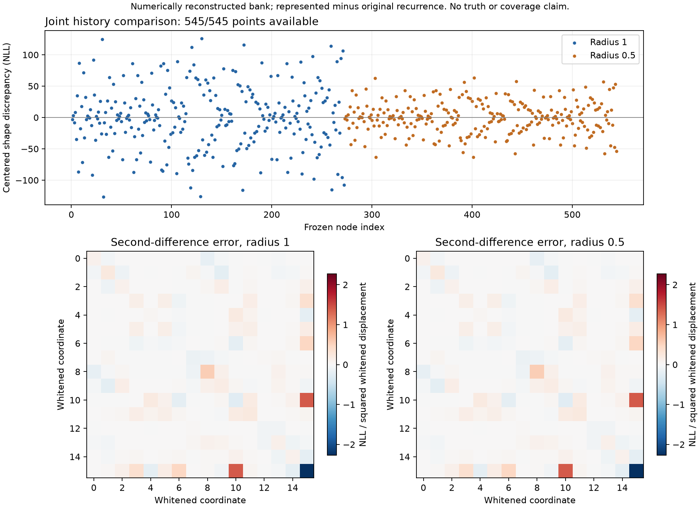

# Fixed-prefix joint likelihood-shape comparison

**The finite comparison completed; the retained history needs repair.** All 545
frozen points were available. Centered likelihood-error oscillation is
**252.960406 NLL**, against the previously registered **0.1 NLL** budget.
The computed-arithmetic interval is **[252.960264, 252.960548] NLL**.
At half the radius the oscillation is still **126.231763 NLL**. This is a
substantive discrepancy in the computed local likelihood shape.

The earlier census's maximum 2.04e-10 NLL replay drift remains a separate result.
It neither explains this discrepancy nor bounds reconstruction differences at
these new points. Original bank coefficients were not saved, so this comparison
characterizes the explicitly identified numerically reconstructed bank.

See the [saved-result review](result_review.json), [decision](decision.json),
[execution receipt](attempt001/receipt.json), [complete analysis](attempt001/analysis.json)
and [all evaluations](attempt001/evaluations.json).



The registered design uses all 16 quantities jointly: 16 whitened basis
directions and 120 normalized pair directions, both signs and radii 1 and 0.5,
plus the saved estimate. All points fit the original common support without
halving. Whitening residual is 2.28e-13. The metric selects the points; it is
not a validated covariance. Exact point bytes and hashes were closed in
[nodes_frozen.json](attempt001/nodes_frozen.json) before any reference evaluation.

The discrepancy is predominantly a local slope mismatch: the maximum absolute
odd directional slope error is 125.624 NLL per whitened unit at radius 1 and
125.621 at radius 0.5. The maximum absolute second-difference matrix entry is
2.27140 at both scales. These are finite differences, not certified derivatives.
Whitened directions mix physical parameters; coordinate 15 is not a standalone
initial-h perturbation. The full matrices and odd slopes are retained in the
analysis rather than reduced to one scalar.

The minimum centered discrepancy is -126.759707 NLL at `r0_axis_15_p`; the
maximum is +126.200699 NLL at `r0_pair_03_10_p`. Their capacity displacements
from the anchor are -0.0096971% and +0.0019216%, and their current-SOC
displacements are +0.0001025 and +0.0005081 percentage points. These are joint
perturbations and do not identify a capacity-only or SOC-only defect.

The anchor's represented likelihood is 145301.917781 NLL versus the recurrence's
151196.853870 NLL. That constant offset is removed from the shape comparison.
Endpoint SOC agrees at every point; RC voltage differences are at most
5.15e-17 V. The largest endpoint-h difference is 0.000599983. These compare
two calculations, not either calculation against physical truth. Matching
terminal states does not establish that historical residuals were preserved.

The comparison used the original ordered 252,000 observations, actual intervals,
ADC codec, calibration and 1 mV residual scale. Each point was evaluated with
the unchanged original recurrence. The identical original prior cancels from
the discrepancy. No optimization, truth read, prefix reconstruction or new
source generation occurred. All nodes ran despite the large discrepancies.

The [plan](plan.json) explicitly adapts a separate copy of the saved census bank
to the old loader format: only byte 4 changes, from `C` to `0`. The
[adapter receipt](attempt001/adapter.json) records both hashes and denies strict
parity certification. The original diagnostic bank, failed strict attempt,
census inventory and inherited numerical code remain unchanged.

Qualification passed [74 bridge/preservation checks](qualification/development001/receipt.json)
and all 21 inherited geometry/decision tests. Four fabricated metrics and 20
reference rows exactly matched the previously qualified results. The
[source checkpoint](https://github.com/tumblewhead/mumble/commit/60a7b1b140991866fb7a04672e384483e414ec9f)
was published and verified before execution. Source and result review were by
the implementation agent, not an independent reviewer. Saved-result checks
verified all hashes, distinct capture copies and 100-digit Decimal centering.

The single comparison used 137,340,000 reference model steps/predictions,
545 represented queries and one separate geometry query/prior evaluation.
It took 43.149664 CPU seconds and 43.087742 wall seconds. Conservative combined
host peak RSS was 67,551,232 bytes; closed execution output including the receipt
was 2,365,625 bytes. All registered limits held. These are external diagnostic
resources, not Cortex-M23 estimator resources.

Commands, each executed once:

```sh
python3 -B experiments/joint_shape_comparison_001/qualify.py
python3 -B experiments/joint_shape_comparison_001/run.py --qualification experiments/joint_shape_comparison_001/qualification/development001/receipt.json --publication experiments/joint_shape_comparison_001/source_publication.json
python3 -B experiments/joint_shape_comparison_001/report_saved.py
```

The next bounded engineering step is to localize the slope mismatch in the
rolling historical factor and carried boundary, then qualify one causal repair
against this saved witness. Do not fix this by recentering from truth, adding
replayed observations as new evidence, or shrinking the stencil until it passes.
Archive replay remains an external diagnostic tool. The present result does not
uniquely identify which approximation caused the mismatch.

M2 remains open and M3 is unpromoted. Computed-cost allowances exclude forward
error in recurrence/libm and physical model error. Finite-point checks do not
establish between-point fidelity, tails, convergence or interval coverage.
Calibrated SOC/capacity uncertainty, varied cell/load/noise/duration trajectories
after stability, and measured complete Cortex-M23 SRAM/timing remain separate
requirements.
