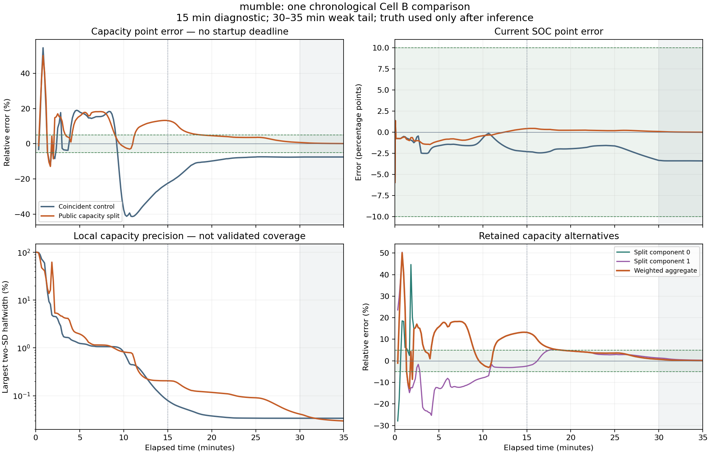

# Two-component learner: capacity improves with later use

## Decision

**Keep the fixed public capacity split as a candidate for further qualification.**
The first declared comparison is complete. At 35 minutes, capacity error is
**+0.09523%** and current SOC error is **−0.00806 percentage points**. The paired
coincident control finishes at **−7.53789%** and **−3.40821 points** respectively.
Both arms complete with zero rejected corrections. This supports later capacity
learning on the tested trajectory, while uncertainty calibration, broader
performance, indefinite operation and Cortex-M23 qualification remain open.

The candidate is **not promoted** to a qualified product or an annual campaign.
Its local ranges remain overconfident. The final capacity range, including the
hull of both components, excludes the known scoring truth. Keep application
accuracy unresolved, coverage unvalidated and hard support unavailable.

Primary evidence: [compact summary](summary.json), [execution receipt](primary/receipt.json),
[independent scores](scores.json), [mechanism decision](decision.json), and
[publication identities](../../provenance/nonlinear_hypothesis_001_publication.json).

## The user's capacity-learning clarification

Before any new primary inference, the user clarified that capacity need not be
discovered immediately, while SOC should become useful promptly. The
[amendment](../../plans/capacity_learning_horizon_001.json) therefore removes a
capacity startup deadline. It preserves the 5% hard and 0.5% preferred capacity
targets, and the 10-point hard and 0.5-point preferred SOC targets.

The original, unexecuted [900-second test](../../plans/nonlinear_hypothesis_falsification_001.json)
remains intact as historical evidence. The new [frozen plan](plan.json) declares
the entire existing 2100-second Cell B trace before execution. The 900-second
checkpoint is diagnostic; 1800 seconds measures later informative use; the
1800–2100-second weak tail measures retention and further adjustment. A finite
miss would leave eventual learning unresolved, and a finite success cannot
prove convergence for every future stimulus.

Exactly two processes ran once each: the coincident control and the public
log-capacity split. Each consumed all 73,500 original samples in order, at the
original intervals, for **147,000 total deliveries**. There was no optimizer,
new data generation, reset, resampling, pruning, reseeding or replay of an old
study. Truth was loaded by the scorer only after both inference processes
closed and their output identities were verified.

## What was implemented

The new [C core](../../src/scm_hypothesis.c) implements the
[frozen two-component contract](../../plans/nonlinear_evidence_design_001.json).
Each component retains its nonlinear state and all 136 entries of a packed
16-coordinate lower covariance factor. A fixed public half-Gaussian moment
split initializes two log-capacity alternatives; it uses no fitted start or
scoring truth. Their original log-state mean and covariance are preserved, but
the mixture density and higher moments differ from the coincident prior.

Pre-correction predictive scores update log weights once per observation.
Components are never removed, even when a displayed linear weight underflows.
The aggregate is a reporting view; it is not fed back as a collapsed inference
state. The capacity point is the exponential of the weighted log-capacity mean,
not a physical-capacity posterior mean or a coverage quantile.

The selected boundary remedy is integrated in both arms. The actual rounded
coordinate correction must remain feasible; a finite out-of-domain trial gets
zero gain for that coordinate before both the mean and full Joseph covariance
are calculated. Any component correction or weight failure rejects the whole
bank's voltage transaction and preserves the physical prediction. Shared input
accounting and separate conditional/bank evidence cursors remain explicit.

The [checkpoint codec](../../src/scm_hypothesis_checkpoint.c) streams a 3004-byte,
versioned, checksummed record without allocating a whole record buffer. Host
save/restore is atomic; embedded inactive-slot NVM and power-loss behavior are
still integration work. The previous bounded candidates remain unchanged.

## Observed learning

Errors below are signed. Capacity uses relative percent; SOC uses percentage
points. Values are from post-inference scoring of the saved chronological
queries, not runtime access to truth.

| Elapsed time | Control capacity error | Split capacity error | Control SOC error | Split SOC error |
| --- | ---: | ---: | ---: | ---: |
| 15 min / 900 s | −22.52286% | +13.16356% | −2.30495 pp | +0.42409 pp |
| 20 min / 1200 s | −9.81554% | +4.59238% | −1.96583 pp | +0.22592 pp |
| 25 min / 1500 s | −7.52974% | +3.59117% | −1.63395 pp | +0.17678 pp |
| 30 min / 1800 s | −7.55929% | +0.75176% | −3.34804 pp | +0.07910 pp |
| 35 min / 2100 s | −7.53789% | +0.09523% | −3.40821 pp | −0.00806 pp |

The split reduces absolute capacity error by **12.41180 percentage points**
between 900 and 1800 seconds, then by a further **0.65653 points** in the weak
tail. The control also improves after 900 seconds, but its final five minutes
change the absolute error by only **0.02140 points**. Thus the evidence supports
continued learning for this candidate and stimulus. It also shows why elapsed
time alone is insufficient: the control retains a substantial bias.

| Split target | First observed hit | Earliest saved query after which every remaining query passes |
| --- | ---: | ---: |
| SOC within 10 pp | 1 s | 1 s |
| SOC within 0.5 pp | 6 s | 580 s / 9 min 40 s |
| Capacity within 5% | 20 s | 1130 s / 18 min 50 s |
| Capacity within 0.5% | 570 s | 1850 s / 30 min 50 s |

The distinction between a first hit and sustained saved-query performance is
essential. Early capacity hits are followed by substantial regressions. The
table does not claim monotonic learning or continuous-time threshold crossing.
Queries occur every second through 10 seconds, then every 10 seconds, with the
declared endpoints included; ingestion remains at nominal 35 Hz. Initial SOC
is unavailable; both arms satisfy the hard SOC target at every one of the
219 subsequent saved queries. Capacity is unavailable at 11 queries including
the initial state and first 10 seconds.

## What the components and uncertainty reveal

At 900 seconds the split still contains a component with capacity error
**−2.43584%**, while its weighted output is **+13.16356%**. The better component's
log weight is about **−1497.02**. This is a concrete weighting/output limitation
at that checkpoint: a useful alternative exists but contributes negligibly.
The late aggregate improvement comes mainly from the dominant component
continuing to learn. It does not demonstrate that the weighting rule recovered
by selecting the previously better alternative.

At 2100 seconds both component capacity errors satisfy the preferred target:
**+0.09523%** and **+0.29263%**. The latter has log weight about **−2187.99** and is
still retained. This comparison establishes a benefit of the declared public
split versus the coincident prior on this trace. It does not isolate whether
two simultaneous components are necessary: the split also changes the prior's
higher moments and component curvature. No single-component ablation was run.

Local precision remains a separate failure. There are **79 saved split queries**
where the aggregate local capacity status is provisional yet point error
exceeds 5%; the control has **191**. Runtime application accuracy remains
unresolved in every query, so these raw local diagnostics cannot masquerade as
validated application guarantees.

The final split estimate is **64.76161 mAh** against **64.7 mAh** scoring truth.
Its local two-SD upper halfwidth is only **0.02965%** of the estimate. The
all-component local capacity hull is approximately **64.74242–64.91513 mAh**,
which also misses truth. The final SOC local interval misses truth as well,
despite excellent SOC point accuracy. More elapsed time has improved the point
estimate without making the local uncertainty trustworthy. All sixteen
estimated coordinates, marginal SDs, current-chart truth and engineering-scaled
errors at the selected checkpoints are retained in `scores.json`.

## Verification and resource boundary

The source was committed before inference as
`74ce065dc2263c36db38c06a91c125cc42511369`. The
[qualification receipt](development/qualification.json) binds implementation,
plan, binary, tests and resource evidence. Published commit identities are
resolved through the publication map; identical trees preserve executed bytes.

- **7,386 core checks pass**, with strict C99 warnings and an independent
  AddressSanitizer/UndefinedBehaviorSanitizer run. The maximum dense-Joseph
  covariance difference is 1.33e-15. Tests cover prediction, full factors,
  actual feasible gains, zero/rank-deficient cases, transactions, evidence
  accounting, public moments and weight underflow/overflow behavior.
- **188 checkpoint checks pass**, including continuation parity and atomic
  rejection of corrupt, truncated or incompatible records. Initial development
  failures, fixes and source-identity limitations remain preserved.
- Both primary arms pass functional, chronology, owned-storage and numerical
  gates. Each records 73,500 predictions and voltage deliveries, with no missing
  voltage or rejected correction. Six complete checkpoints are preserved.

| Resource figure | Meaning |
| --- | --- |
| **7152 B** | Measured named estimator objects: live bank, complete workspace/staging, serialized query arena, configuration and input |
| **10032 B** | Proposed complete target budget, including unmeasured acquisition, RAM support and 2048 B stack/math/caller/IRQ reserves |
| **208 B** | Remaining space against 10240 B under that planning allocation |
| **9624 B** | Named host objects plus a partial own-source save-path stack sum; external runtime costs excluded |

The [memory account](memory_accounting.json) and
[independent resource review](independent_resource_review.json) distinguish
these figures. No actual M23 compiler or device was used. Target ABI, complete
stack/software math/runtime, interrupts, acquisition and deadlines remain
unmeasured. A fixed number of objects and operations does not establish an
all-prefix numerical invariant: finite counters and cumulative log odds still
require a lifetime contract.

## Stop and next decision

This experiment stops after the one declared comparison. Preserve its first
outputs and the earlier failures. Keep the candidate and the no-startup-deadline
capacity requirement; do not retune the split, noise, weights or horizon from
these results.

The next bounded task is to freeze one continuous learning/retention validation
contract: carried plant and estimator state, a finite declared horizon, weak
use followed by renewed informative input, honest uncertainty diagnostics and
explicit numerical/resource stop conditions. It must identify what additional
evidence would distinguish retained learning from misleading local precision.
Do not concatenate the existing CSV with a reset plant or repeated noise, and
do not proceed directly to annual simulation. The broader short-case, lifecycle,
target and lifetime obligations remain on the [roadmap](../../docs/ROADMAP.md).
