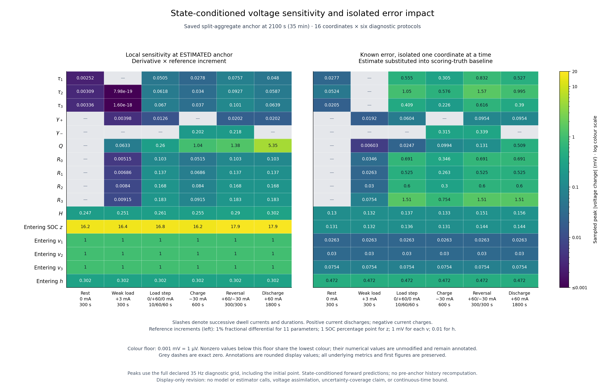
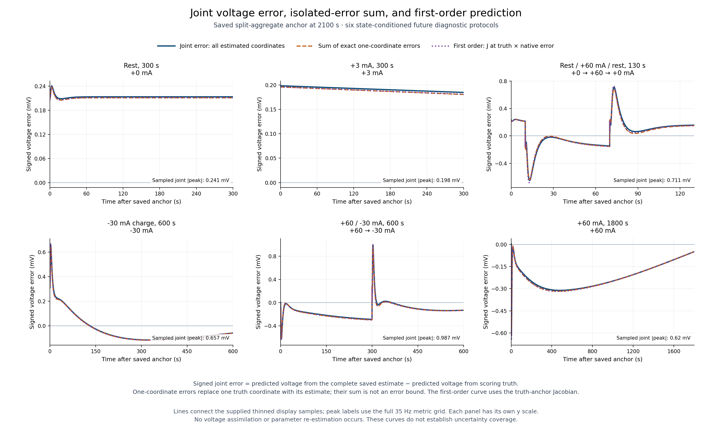

# Parameter sensitivity 001: what the remaining estimation errors change

## Result and decision

**The remaining percentage errors in individual parameters substantially overstate some practical output errors in this saved result.** At the final 2100 s estimate, τ₂ is +19.24% wrong, but its largest isolated terminal-voltage effect across six declared future protocols is **1.571 mV**, during current reversal. The complete estimated vector produces a maximum sampled voltage error of **0.987 mV** and a maximum direct propagated SOC error of **0.036053 percentage point** across those protocols. These are conditional point predictions under the existing synthetic model.

The conclusion is to **keep the unchanged learner for further qualification and assess error by its effect on useful outputs under specified use**. Capacity and prompt SOC retain their existing targets. There is no basis here for imposing the same percentage accuracy on every nuisance parameter, removing parameters, tuning the estimator, or treating its local uncertainty as validated. The [decision](decision.json) closes this sensitivity study; the next task remains one finite continuous learning/retention validation contract.

The analysis ran once from a frozen source and plan. It uses the previously saved split-aggregate estimates at 900, 1800 and 2100 s. It does not rerun the learner, assimilate observations, alter prior results, or add estimator SRAM. The [compact summary](summary.json), [complete metrics](primary/results.json), [execution receipt](primary/receipt.json) and [independent audit](independent_review.json) retain the exact numbers and scope.

## What was measured

For each of sixteen coordinates, the analysis answers two distinct questions:

1. **Intrinsic local sensitivity:** how much would voltage change per common reference increment at this estimate? The eleven positive parameters use a 1% fractional differential. SOC uses one percentage point, each entering RC voltage uses 1 mV, and hysteresis state h uses 0.01.
2. **Effect of the error we actually have:** starting from the saved scoring-truth vector, replace one coordinate by its saved estimate and propagate the exact nonlinear model. All other coordinates stay at scoring truth. This measures an isolated finite effect without assuming the error is small.

The complete estimated vector is also propagated and compared with the complete scoring-truth vector. Signed isolated effects are summed before taking any magnitudes; their difference from the complete error is recorded as a cross-coordinate interaction remainder. One-coordinate repairs of the complete estimated vector provide a separate conditional counterfactual. None of these decompositions is a unique attribution of causal responsibility.

Every future protocol independently starts from the saved **current** states. Changing a parameter does not reconstruct the preceding history that produced those states. Thus, for example, capacity has zero future sensitivity at rest in this calculation, although earlier capacity errors could already have affected the entering SOC estimate.

| Future protocol | Input and duration | Purpose |
| --- | --- | --- |
| Rest | 0 mA for 300 s | Current state offsets and RC relaxation |
| Weak load | +3 mA for 300 s | Repetitive weak-use behavior |
| Load step | 0 mA for 10 s; +60 mA for 60 s; 0 mA for 60 s | Load and relaxation transients |
| Charge | −30 mA for 600 s | Charging hysteresis and capacity response |
| Reversal | +60 mA for 300 s; −30 mA for 300 s | Direction change, RC modes and hysteresis |
| Sustained discharge | +60 mA for 1800 s | Resistance combinations and accumulated capacity error |

Positive current discharges. These are hypothetical diagnostic inputs within the existing lab trace's current range, not hardware stimulus recommendations. The model remains the supplied three-RC, 25 °C, known illustrative OCV model, with exact current and timing and no generated measurement noise. Parameters stay fixed during each prediction.

All metrics use the declared 35 Hz grid with 1/35 s intervals. Peaks include the initial voltage under the first protocol current. Later instantaneous switching limits are not separately inserted. RMS excludes the initial point and uses all equal-duration samples. Therefore a reported peak is a **sampled peak**, not a continuous-time supremum.

## All eleven parameter errors at the final estimate

The two right columns below are maxima over the six protocols, taken separately. The local column evaluates the derivative at the estimated vector; it is not an exact finite +1% perturbation. The final column evaluates the actual saved finite error in isolation.

| Parameter | Saved signed estimation error | Peak local effect per 1% differential, mV | Peak isolated effect of actual error, mV |
| --- | ---: | ---: | ---: |
| τ₁ | +12.14253% | 0.0757 | 0.8318 |
| τ₂ | +19.24038% | 0.0927 | 1.5710 |
| τ₃ | +5.80476% | 0.1009 | 0.6164 |
| γ₊ (discharge) | -5.05484% | 0.0202 | 0.0954 |
| γ₋ (charge) | -1.54650% | 0.2177 | 0.3385 |
| Q | +0.09523% | 5.3491 | 0.5094 |
| R₀ | +7.20082% | 0.1029 | 0.6913 |
| R₁ | +3.97894% | 0.1373 | 0.5252 |
| R₂ | +3.70428% | 0.1680 | 0.6001 |
| R₃ | -7.61132% | 0.1829 | 1.5070 |
| H | +0.52017% | 0.3016 | 0.1560 |

τ₁, τ₂ and τ₃ have their largest actual-error effects during the +60 to −30 mA reversal. τ₂'s 1.571 mV peak occurs about 0.714 s after that switch; its RMS effect over the 600 s reversal protocol is only about 0.087 mV. It is a short transient error, whereas the R₃ error can leave a sustained offset near 1.507 mV under 60 mA load. Peak and RMS answer different application questions.

The final capacity error is small, but capacity is intrinsically influential over a large charge movement: the maximum local sensitivity is 5.349 mV per 1% differential for the 1800 s discharge. A weak current for a short time exposes far less capacity effect. Hysteresis rate γ₋ is more influential than γ₊ under these starting conditions, even though its relative error is smaller. The entering h is approximately +0.83, so the two directions do not begin with symmetric hysteresis displacement.

This is why a ranking based only on percentage error would give a misleading work order. τ₂ and R₃ have the largest isolated remaining voltage effects in this fixed set, but Q becomes a major concern if its estimate is appreciably worse or the net charge movement is larger.

## All five entering-state errors

| State | Saved signed error | Reference increment | Peak local effect per reference increment, mV | Peak isolated effect of actual error, mV |
| --- | ---: | --- | ---: | ---: |
| Entering SOC z | -0.00806213 pp | 1 SOC percentage point | 17.9000 | 0.1443 |
| Entering RC voltage v₁ | +26.2610 µV | 1 mV | 1.0000 | 0.0263 |
| Entering RC voltage v₂ | +30.0046 µV | 1 mV | 1.0000 | 0.0300 |
| Entering RC voltage v₃ | -75.3520 µV | 1 mV | 1.0000 | 0.0754 |
| Entering hysteresis state h | -0.01574470 | 0.01 dimensionless h | 0.3016 | 0.4723 |

An entering RC voltage error initially contributes directly to terminal voltage and then decays with its RC mode. The table includes the initial point; it does not imply a persistent effect. An entering h error contributes through −Hh and persists at rest in this model. The small entering SOC error contributes about 0.144 mV at the steepest OCV portion reached by these protocols.

Only Q and entering SOC directly change propagated SOC here. The other fourteen coordinates can affect an operating estimator's SOC through subsequent voltage corrections, but that feedback is outside this open-loop analysis. Their zero direct SOC derivative must not be reported as zero importance to an operating estimator.

The heatmap shows how strongly importance changes with operating regime. Exact zeros are grey; the colour scale clips below 0.001 mV (1 µV), with raw values retained in annotations and metrics. Tiny weak-load time-constant entries are floating-point residuals around an already settled entering RC state, not useful evidence of observable information.

## What the complete estimate predicts

| Future protocol | Joint peak absolute voltage error, mV | Joint voltage RMS, mV | Maximum absolute direct SOC error, pp |
| --- | ---: | ---: | ---: |
| Rest, 300 s | 0.2412 | 0.2139 | 0.008062 |
| +3 mA, 300 s | 0.1983 | 0.1915 | 0.008062 |
| 0 / +60 / 0 mA, 10 / 60 / 60 s | 0.7106 | 0.2095 | 0.008062 |
| −30 mA charge, 600 s | 0.6569 | 0.1248 | 0.015415 |
| +60 / −30 mA reversal, 300 / 300 s | 0.9869 | 0.1936 | 0.008062 |
| +60 mA discharge, 1800 s | 0.6201 | 0.2321 | 0.036052 |

The largest final-anchor joint voltage peak is **0.986852 mV**, during reversal. These values concern noiseless model prediction error from the saved estimates. The inherited measurement-noise scale of 1 mV is a useful reference only: errors below it are not automatically harmless, and the reference is not an acceptance threshold. Repeated small systematic effects can matter, while a large response can remain confounded with other coordinates.

### Compensation is substantial

At a settled +60 mA discharge, the four resistance errors contribute approximately:

| Resistance error | Signed isolated terminal-voltage effect |
| --- | ---: |
| R₀ | −0.69128 mV |
| R₁ | −0.52522 mV |
| R₂ | −0.60009 mV |
| R₃ | +1.50704 mV |
| **Combined resistance effect** | **−0.30955 mV** |

The true resistance sum is 0.98 Ω and its estimate is 0.985159 Ω, only about +0.526% different, although the individual errors range from roughly 4% to 8%. These are a shared settled-current limit; the calculation does not add peaks occurring at different times.

For the long discharge, RMS of the pointwise sum of absolute isolated effects is **3.94750 mV**, while the complete joint RMS is **0.23209 mV**. The former is a scale diagnostic, not a certified upper bound. The final-anchor maximum nonlinear cross-coordinate remainder is **0.05538 mV**, and the maximum residual against a first-order approximation is **0.11282 mV**. Much of the compensation therefore comes from signed contributions rather than a large nonlinear interaction.

A useful conditional counterexample: at the end of the long discharge the complete voltage error is **−0.04909 mV**. Replacing only R₃ by its true value, while leaving every other estimated quantity unchanged, would produce approximately **−1.55613 mV**. This does not recommend keeping a wrong resistance. It demonstrates why correcting or fixing parameters in isolation can break a jointly fitted explanation.

The six panels have separate vertical scales. Profile storage is compact: it retains the first 10 s of each dwell densely plus uniformly selected times and boundaries. Full-grid metrics were computed before this display reduction. The sparse profile points must not be treated as uniform samples to recompute RMS.

## Capacity error matters through charge movement

Let C(t) be the signed charge drawn after the anchor, in Ah. With positive current for discharge,

\[
z(t)=z_a-\frac{C(t)}{Q}.
\]

For a relative capacity error \(\epsilon=\widehat Q/Q-1\), holding entering SOC fixed, the exact capacity-only SOC error is

\[
\Delta z_Q(t)=\frac{C(t)}{Q}\frac{\epsilon}{1+\epsilon}.
\]

For the final saved comparison, Q_true = 0.0647 Ah, Q_est = 0.0647616145 Ah, ε = 0.0009523113, and the 1800 s, 60 mA discharge moves 0.03 Ah. This gives **+0.044115 pp** of capacity-only SOC drift. Adding the saved entering SOC error of **−0.008062 pp** gives **+0.036052 pp** at the end. That direct SOC calculation is exact under the declared fixed model, known input and state conditioning.

At rest, elapsed time alone causes no capacity-driven SOC drift in this model. Larger net discharge amplifies a fixed capacity error. Alternating charge and discharge can cancel net charge in this fixed, unit-efficiency SOC equation, although their voltage transients and hysteresis still provide different observations to an estimator. This sensitivity study does not evaluate how much those observations would teach the learner.

The same future long discharge can also be started from each of the three saved estimates:

| Saved estimate | Capacity error | Joint peak voltage error over follow-up, mV | Q-only final SOC drift, pp | Joint final SOC error, pp |
| --- | ---: | ---: | ---: | ---: |
| 15 min | +13.16356% | 61.8819 | +5.393661 | +5.817749 |
| 30 min | +0.75176% | 3.0475 | +0.345974 | +0.425071 |
| 35 min | +0.09523% | 0.6201 | +0.044115 | +0.036052 |

These are **frozen-snapshot forecasts**, not additional learning runs. They show a practical consequence of the better later estimate: under this long-discharge follow-up, the modeled joint peak drops from about 61.88 to 0.620 mV and final SOC error from +5.818 to +0.0361 pp. The comparison also changes entering physical state, and it does not imply all protocols improve monotonically; rest RMS is nonmonotonic across the anchors. It supports evaluating capacity after informative use without imposing a startup deadline, while leaving eventual long-run convergence open.

### Why a large time-constant percentage error can have a small voltage effect

For one constant-current RC dwell,

\[
v(t)=RI+(v_a-RI)e^{-t/\tau},\qquad
\frac{\partial V}{\partial\log\tau}
=(RI-v_a)\frac{t}{\tau}e^{-t/\tau}.
\]

If the entering RC voltage was settled at the previous current, the first-order peak magnitude is approximately

\[
\frac{R|\Delta I|}{e}\,|\Delta\log\tau|,
\]

near one time constant after the switch. The resistance and size of the current step set the voltage scale; the percentage time-constant error alone does not. The τ₂ reversal has R = 0.27 Ω and a 90 mA current change, consistent with the observed roughly 1.57 mV finite effect.

## Actual SOC error and an SOC-equivalent voltage error differ

The full metrics also report \(100\,\Delta V/U'(z)\), evaluated pointwise using the truth trajectory's OCV slope. This asks how far SOC alone would have to move locally to explain a voltage discrepancy while all other voltage terms are held fixed. It is an **OCV-equivalent proxy**, not actual SOC error, a filter correction, or an uncertainty bound.

At the final long-discharge endpoint, actual SOC error is **+0.036052 pp**, while the voltage-derived proxy is **−0.004252 pp**. Even their signs differ because resistance, RC and hysteresis errors also contribute to voltage. The analysis and plots keep these quantities separate.

## Verification, provenance and limits

The frozen source is df4c4b6dd56bcffd88de3b06c1d3e818a0dc0184, with identical published source tree at 77d72301ba1a8aba4361d5bc28954cb6bcd42714. The [publication map](../../provenance/parameter_sensitivity_001_publication.json) resolves commit identities and preserves original development history.

Prerequisite qualification passed **188 assertions** against the unchanged production C physical model, independent closed forms and central finite differences on short public fixtures. Maximum physical-model discrepancy was 6.22×10⁻¹⁵ and maximum derivative discrepancy was 1.94×10⁻¹⁰ in the checker's corresponding native units. The checks preceded the saved-vector sensitivity evaluation.

The primary evaluated **612 trajectories and 13,316,100 diagnostic intervals**: 3 anchors × 6 protocols × (truth + complete estimate + 16 isolated substitutions + 16 repairs). Every declared physical domain passed, and the first execution completed. The independent result audit reconciled hashes, domains, counts, charge identities, scaling, signed arithmetic and selected saved peaks/endpoints against C. Its 69 point evaluations required 110 constant-current C chunks, with no full-grid trajectory rerun; selected voltage values agreed within 8.89×10⁻¹³ mV.

The [preflight receipt](development/preflight.json) preserves an orchestration-only failure before the primary: an empty failure list was incorrectly compared with integer zero. The check was corrected and recorded without changing the numerical algorithm or rerunning prerequisite tests. The first heatmap and its hashes remain preserved; a display-only wrapper makes labels and colour scaling readable. The [display receipt](figures_readable/display_receipt.json) binds both plotters and records zero additional model calls or metric changes.

The full [verification receipt](verification.json) and separate [interpretation review](interpretation_review.json) accompany the results. The analysis adds **zero bytes to the estimator**. Offline arrays and plot files are not embedded storage or a Cortex-M23 qualification.

Sensitivity does not establish identifiability, posterior probability, an uncertainty interval, hard support or coverage. The analysis propagates an aggregate mean, not the full mixture distribution or covariance. It assumes the existing exact current/time, fixed parameters, known illustrative OCV and matched 25 °C model. Temperature, aging, sensor bias, OCV mismatch, current/timing uncertainty, real-cell validation, end-of-discharge behavior and continuous estimator feedback are outside scope.

The previous local uncertainty failures remain open even though these point predictions are good. The learner is retained for further qualification, not promoted. Generalization, complete target resources and full-model indefinite behavior also remain open.

## Next decision

Freeze one continuous learning/retention validation contract for the unchanged learner. It should preserve carried plant, estimator, noise and input-index state; separately assess prompt SOC, capacity acquisition, weak-use retention and renewed excitation; and include output-level diagnostics across rest, transients, sustained load, charge and reversal. Capacity error should be interpreted alongside accumulated charge and useful target availability.

The contract must predeclare whether a short second-cell/lifecycle gate precedes a duration pilot, its finite work/logging budget, its uncertainty interpretation and failure stops. This analysis neither launches nor qualifies a 24-hour, week or annual campaign. Stop this diagnostic here; do not use these scoring-truth effects to retune parameters or priors.
