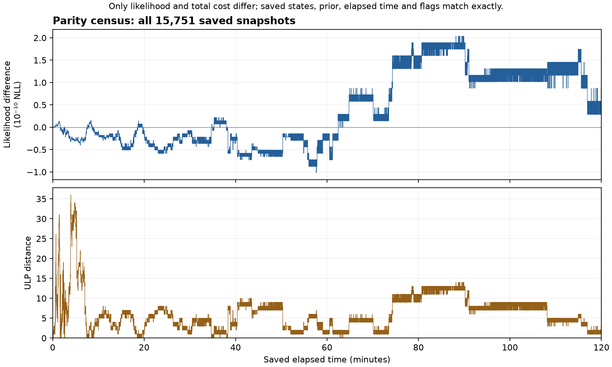

# Parity mismatch census

This separate diagnostic implements the user-requested continuation through
finite output mismatches. The previous exact-parity attempt and its failure
remain preserved in `../fixed_prefix_shape_001/attempt001`.

The pass covers all 15,751 saved snapshots in the original 252,000-record
two-hour prefix. It starts from the public mean and commits original decoded
records using each saved accepted estimate. It performs no optimization, truth
scoring or original-recurrence node comparison.

Every snapshot is retained in `actual_snapshots.bin`. The analysis emits a
lossless `mismatches.csv.gz`, per-field counts and worst cases, ULP histograms,
longest mismatch runs, and fixed 15-minute summaries. Absolute SOC differences
are also reported in percentage points and voltage differences relative to the
existing 1-mV likelihood sigma. These are descriptive scales, not acceptance
tolerances or physical-truth errors.

The numeric/flag comparisons never correct carried state or abort the pass.
Structural failures still stop it: invalid or changed input, wrong order,
nonfinite data, unusable bank, failed commit/query, or resource exhaustion.
The diagnostic bank uses a distinct checkpoint magic and does not satisfy the
previous exact-bank identity gate.

Qualification passed eight unit tests, eight continuation/preservation checks
and three structural-failure cases. Injected tiny, signed-zero, flag and large
late differences were all reported through the final snapshot, with identical
reconstructed output and bank bytes. See [plan](plan.json),
[qualification](qualification/development001/receipt.json) and
[source review](source_review.json). Review is by the same assistant.

## Completed result

The full census completed once at source revision
`9c57d06c15416e6848c10144e3a83ca2066c036c`, which was published before execution.
All 252,000 records and 15,751 snapshots were processed. There were no structural
failures, optimizer calls, truth reads or original-recurrence reference passes.

| Saved field | Mismatching snapshots | Maximum absolute difference | Maximum ULP distance |
|---|---:|---:|---:|
| Likelihood cost | 15,546 | 2.0372681319713593e-10 NLL | 36 |
| Total cost | 15,546 | 2.0372681319713593e-10 NLL | 36 |
| Prior cost, elapsed time, SOC, RC states, hysteresis, support slacks and flags | 0 | 0 | 0 |

The sixteen accepted x coordinates also match exactly, as expected from installing
them by construction. The 31,092 scalar mismatches affect only the two cost fields.
The first occurs at sample 224 and exactly reproduces the previous strict failure.
The largest absolute discrepancy occurs at sample 185,232, about 88.21 minutes.
The final likelihood discrepancy is 5.820766091346741e-11 NLL. Maximum relative
cost error is 4.760794704716981e-15. Every total equals its binary64 likelihood
plus the same prior; one snapshot has a 2.27e-13 difference between the two deltas
due to final-addition rounding.

For scale, the maximum cost discrepancy is about 2.04e-9 of the existing 0.1-NLL
shape budget. This is magnitude context, not a proof of joint-shape fidelity.
The observed saved-output differences are negligible at the stated application
scales. Compiler, standard-library and accumulation differences remain plausible
causes; this census does not establish which operation differs. The unsaved
original bank coefficients remain unavailable for direct comparison.

[Complete mismatch CSV](attempt001/mismatches.csv.gz),
[per-field/time-window summary](attempt001/summary.json),
[saved-output review](result_review.json), [decision](decision.json),
[execution receipt](attempt001/receipt.json).

Execution used 504,000 model steps, 252,000 QR rows, 31,501 queries and 15,751
prior evaluations. Supervisor plus child CPU was 1.44 seconds and wall time
1.48 seconds. The conservative combined peak RSS was 61,919,232 bytes;
closed execution output including its receipt was 8,850,535 bytes. These are
host diagnostic resources, not firmware measurements.

The saved-data review independently recomputed counts and maxima from the
retained binary outputs and verified every CSV row, all recorded hashes and
both binary copies. It was performed by the same assistant. Its first development
assertion incorrectly assumed equal likelihood/total deltas despite final
floating-point addition; that failed review and source are preserved in
`reporting_development001`, with no census rerun.

## Next action

Use the retained diagnostic bank for the fixed-prefix joint-shape comparison
with explicitly documented numerical reconstruction semantics. Do not require
another prefix replay to obtain that bank, and do not reinterpret the old
exact-parity result as a pass. The census supplies evidence that the observed
saved-output drift is negligible; the joint comparison will test local shape.
The requested cell/load/noise/duration campaign remains a subsequent capability
once development is stable.
