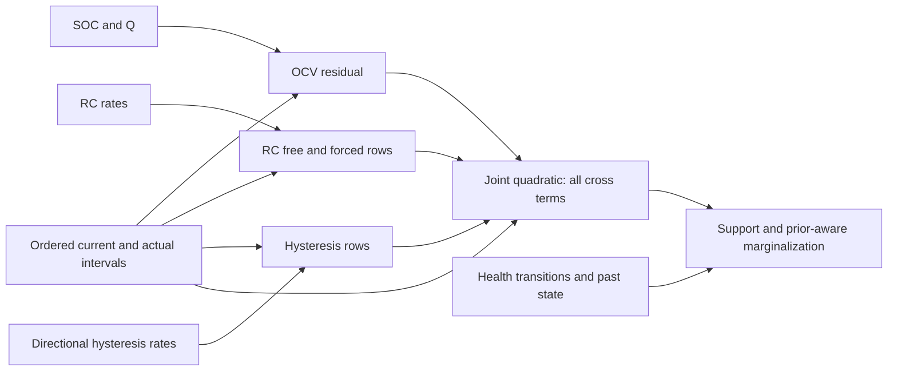

# Partitioned battery closure: what composes, and what remains a function

This is a derivation from the repository's original three-RC equations and
the specified minimal health model. It extends the
[ten-year lemmas](../ten_year_history_001/lemmas.md) and
[Gaussian reference](../../experiments/incremental_history_001/derivation.md).
The claims below are conditional mathematical arguments, not independently
reviewed proofs or a full battery history certificate.

## B1. Exact stationary conditional amplitude structure

Let signed charge c_k=sum_{j<=k} I_j dt_j/3600, and let
eta=(log tau_1:3, log gamma_+, log gamma_-, z_0, log Q). For each fixed eta,

    z_k = z_0-c_k/Q
    a_i,k = exp(-t_k/tau_i)
    f_i,k = e_i,k*f_i,k-1 + (1-e_i,k)*I_k,   f_i,0=0
    h_k = a_h,k*h_0+b_h,k
    a_h,k = e_h,k*a_h,k-1
    b_h,k = e_h,k*b_h,k-1+(1-e_h,k)*sign(I_k)

with a_i,0=a_h,0=1, b_h,0=0; at rest e_h=1. The original voltage is

    mu_k = U(z_k) + X_k alpha
    alpha = (R0,R1,R2,R3,H,v1,0,v2,0,v3,0,B), B=H*h_0
    X_k = (-I_k,-f1,k,-f2,k,-f3,k,-b_h,k,-a1,k,-a2,k,-a3,k,-a_h,k).

Every term follows by substituting the affine state recurrences into
U(z)-I*R0-sum(v_i)-H*h. No rate, capacity or amplitude uncertainty has been
discarded: eta is an argument at which the conditional function is evaluated.
This structure is already present in `scm_model_step` and `desktop_eval`.
It is not a newly discovered nine-parameter replacement for the sixteen-state
problem.

Put r_k=[X_k, U(z_k)-y_k]/sigma. For a fixed eta, QR accumulation gives an
upper triangular 10-by-10 matrix S with

    L(eta,alpha) = ||S(eta)*[alpha;1]||^2/2 + n*log(sigma*sqrt(2*pi)).

Its 55 upper-triangular scalars retain all squared residual and cross terms.
Equivalently store G=sum r_k' r_k, but direct evaluation of G can cancel near
zero residual; the square-root form avoids that subtraction. This is a
conditional likelihood, not a posterior covariance or a Gaussian assumption
about alpha. The crucial distinction is **55 scalar functions of eta**, not
55 constants valid at every eta.

## B2. Exact chronological block composition at compatible eta

For a block A retain its a_i,f_i,a_h,b_h, signed charge c_A, duration and
source interval. Its amplitude boundary map is linear:

    alpha_B = T_A alpha_A
    R0,R_i,H unchanged
    v_i,B = a_i,A*v_i,A + f_i,A*R_i
    B_B = a_h,A*B_A + b_h,A*H
    eta_B = (same rates, z_A-c_A/Q, same log Q).

For B built at this compatible eta_B, let M_A=diag(T_A,1). Then

    S_AB = qr_upper([S_A; S_B*M_A])
    T_AB = T_B*T_A
    c_AB = c_A+c_B.

The norm identity proves equality of conditional likelihoods and endpoint
maps. Associativity follows from substitution and addition of the same owned
residuals; finite QR roundoff is separate. Disjoint adjacent source intervals,
matching model/noise/calibration and correct shifted SOC are prerequisites.
A factor built at another eta cannot simply be relabeled or shifted in place.

The operator is also a deterministic member of the preceding Gaussian
reference: J=G[:9,:9], h=-G[:9,9], c=G[9,9]/2+n*log(sigma*sqrt(2*pi)),
A=T_AB, b=0, Q_process=0. That correspondence does not license replacing the
original supported prior by an unbounded Gaussian.

## B3. Path support and the amplitude chart are part of the object

For stationary Q, all-prefix SOC legality is exactly

    z_0-c_max/Q >= 0;  z_0-c_min/Q <= 1.

The extrema include the entering c=0. Under composition,
c_min,AB=min(c_min,A,c_A+c_min,B) and similarly for the maximum.
Final SOC alone is insufficient: discharge then recharge can leave a legal
endpoint after an illegal intermediate state.

With inherited |I|<=0.25 A, 0<=R_i<=1 ohm, |v_i,0|<=0.08 V,
the stationary RC recurrence is a convex combination of values in
[-0.25,0.25] V. Thus this particular RC support is preserved at every step.
Likewise h remains in [-1,1]. This proof uses those support/current bounds
and voltage continuity; it does not apply automatically to an aging C jump.

The transformed amplitude support includes H>=0 and |B|<=H. For H>0 the
prior density in (H,B) is p(H,B/H)/H, conditional on other original variables.
At H=0 the map collapses and B=0; a separate boundary treatment is required
if a model assigns mass there. Querying in the original (H,h_0) chart avoids
division by H entirely. A quadratic likelihood does not make this constrained
prior Gaussian. Integrating alpha with its original support/prior generally
introduces nonquadratic eta-dependent normalizers. Maximizing over alpha is
a different operation and cannot substitute for marginalization.

## B4. An exact OCV coordinate change helps transport, not likelihood closure

For the inherited U(z)=3+1.15*z+0.08*tanh(8*(z-0.5)), put
t=tanh(8*(z-0.5)). A known SOC decrement d gives the exact Möbius map

    t' = (t-u)/(1-u*t),   u=tanh(8*d).

This is the projective action of [[1,-u],[-u,1]]. Matrix multiplication
composes successive decrements, up to an irrelevant nonzero scalar. The
linear z part transports separately. On the legal real domain the denominator
is positive. The transform therefore answers the earlier coordinate question:
OCV transport has a compact exact rational representation. It does **not**
turn squared voltage residuals into a closed finite quadratic likelihood.

Proof of the obstruction: with w=exp(16*(z_0-0.5)), a shift d produces

    tanh(8*(z_0-d-0.5)) = (w-b_d)/(w+b_d), b_d=exp(16*d).

Distinct d give distinct simple poles -b_d with nonzero residues. A finite
linear combination vanishing on an open physical interval must vanish as a
rational function; inspecting each pole forces its coefficient to zero.
Thus arbitrarily many distinct shifts yield arbitrarily many independent
functions. Squaring residuals adds products and double poles; it does not
remove this obstruction. A rational encoding that retains all distinct poles
grows in degree. Repeated *identical conditional factors* can aggregate;
merely similar current pulses at different SOC cannot be merged exactly on
that basis alone.

## B5. Unknown RC rates also prevent a fixed exact additive span

Even at rest, a carried RC voltage is v_0*exp(-lambda*t). For n distinct
sample times t_j, the functions exp(-lambda*t_j) are linearly independent
on any open positive-rate interval: differentiate an assumed zero sum
0 through n-1 times at lambda_0. The resulting matrix is a Vandermonde in
-t_j times nonzero exp(-lambda_0*t_j), hence invertible.

Why is this a likelihood obstruction? Changing only one observed y_j by
delta changes its Gaussian NLL by -delta*mu_j/sigma^2 plus a parameter-
independent constant. Any fixed additive basis that exactly represents all
such observation histories must therefore also span these response functions.
B4 and B5 rule out that finite fixed basis for arbitrary distinct shifts/times.
They do **not** prove impossibility of every compressed representation or of
useful bounded-error compression, nor permit unlimited information in an
infinite-precision scalar. Finite event dictionaries and finite-bit domains
need their own size accounting. The prior Cayley-series recurrence preserves
formal coefficients but still has a truncation remainder in physical values.

## B6. The dependency graph identifies where specialization is possible

The coefficients depend on small overlapping coordinate subsets. RC_i rows
depend only on tau_i; hysteresis rows on (gamma_+,gamma_-); OCV residuals on
(z_0,Q); ohmic rows contain only measured current. Products create the graph:

OCV/RC cross coefficients use (z_0,Q,tau_i), RC_i/RC_j use two rates,
RC/hysteresis uses three rates, and OCV/hysteresis uses four coordinates.
Separate fits to marginals would delete these edges. The graph supports
specialized low-dimensional function approximations **with common ownership
and a joint remainder**, rather than independent partition posteriors.
The square-root entries may mix more coordinates under factorization; these
small dependencies belong to the underlying Gram coefficients and response
functions, not automatically each QR entry. A stable structured realization
must preserve the joint PSD property and account for arithmetic.

## B7. Known aging paths retain affine transport; unknown paths do not disappear

Under the existing SOC-continuous convention,

    z_N = z_0 - sum_k I_k*dt_k/(3600*Q_(k+1)).

Neither final Q nor total terminal charge determines this sum. Two paths
with equal endpoints can yield different SOC and voltage. Conditioning on a
complete known health/rate path makes fast-state affine recurrences possible,
but that is a path-conditional primitive; marginalization must integrate all
admitted paths with their normalized transition weights.

For proposed RC aging, tau=R*C does not fix the boundary state transfer.
Two distinct empirical choices are:

    voltage-continuous: v_plus=v_minus
    branch-charge-continuous: C_plus*v_plus=C_minus*v_minus.

With known positive C path, the latter inserts kappa=C_minus/C_plus before
the usual interval propagation: v_next=e*kappa*v_old+(1-e)*R_new*I.
Both maps are affine conditional on the path. They differ physically and
produce different predictions. Under charge continuity shrinking C can
increase |v|, so the stationary convex-support proof no longer suffices.
For continuously changing ideal capacitance, charge continuity gives an
additional -(C_dot/C)*v term in v_dot compared with a voltage-continuous
parameter-update model; a fitted equivalent-circuit C need not be a literal
charge-storage capacitor. Neither choice is silently selected here.

Holding tau fixed while varying R means C=tau/R changes dependently. This
conditional stationary amplitude partition does not justify independently
aging R and C while ignoring their effect on tau. The proposed relative
envelopes specify no transition rate, common reference uncertainty or law of
stored polarization transfer.

## B8. Bounded health transitions are not the unbounded Gaussian reference

The existing one-coordinate health kernel is

    K(y|x) = phi((y-x-m)/s) / (s*Z(x)),  y in [L,U],
    Z(x)=Phi((U-x-m)/s)-Phi((L-x-m)/s).

log Z(x) is generally nonquadratic. Composing two such kernels integrates a
product containing 1/Z(intermediate_state); this generally is not another
single truncated-normal increment with doubled variance. Even an unbounded
linear Gaussian reference ceases to be closed after imposing these supports
and the nonlinear observation law. Zero variance remains an exact constraint.
Coarsening transitions, omitting normalizers or discarding unsupported tails
would change the model; none is authorized by the Gaussian prototype.

## B9. A physical residual bound gives an explicit likelihood error budget

On a shared exact supported path domain, suppose each approximation changes
only predicted voltage by delta_k, with |delta_k|<=epsilon_k. Then

    Delta L_k = (mu_k-y_k)*delta_k/sigma_k^2
                +delta_k^2/(2*sigma_k^2)
    |Delta L| <= B_N = sum_k (M_k*epsilon_k+epsilon_k^2/2)/sigma_k^2,

where M_k bounds |mu_k-y_k| on that domain. This retains cross-term effects;
response-error cancellation may improve an evaluated case, but cannot be
assumed for a uniform bound. For the inherited supports one conservative
voltage range is [U(0)-1.10,U(1)+1.10] V, since |I R0|<=0.25,
sum|v_i|<=0.75 and |Hh|<=0.10. The finite observed y then gives M_k.
No sensor-tail probability or truth value is needed for this algebraic bound.

With the same prior, transitions, support and exact state/query maps,
the posterior log-density oscillation is at most 2*B_N. Marginalization and
exact pushforward cannot increase that bound. Hence for a query g of range W,

    |E_tilde[g]-E[g]| <= W*tanh(B_N/2).

A chosen **compression allocation** epsilon_g therefore requires
B_N<=2*atanh(epsilon_g/W). This is separate from actual-cell point accuracy
and coverage; the existing preferred SOC/Q targets do not assign the entire
error budget to compression. No numeric allocation is selected in this study.

If transition log densities also have uniform error on the same support,
their oscillation budgets add. A changed deterministic state map/support can
make the strong distance infinite; small voltage error alone does not bound
SOC, capacity, state-transfer or support errors. A different query metric is
possible only with its own propagation proof.

Without a proved contraction or another tighter accumulated bound, a fixed
per-record epsilon consumes budget with N. A gallery may keep bounded storage
while its likelihood defect grows. Conversely physical RC endpoint errors
obey a genuine recurrence

    |dv_N| <= product(e_k)*|dv_0| + sum_j product_{k>j}(e_k)*step_error_j.

That can attenuate state error in elapsed time; it does not erase already
accumulated likelihood errors. Hysteresis attenuates in charge throughput,
not at rest. SOC error from uncertain varying inverse capacity is a charge-
weighted path sum. These mechanisms need separate budgets.

## B10. Decision and storage consequences

The useful exact object is a **conditional response/likelihood operator field**,
with the original joint prior and legal domain outside it. A single fixed-eta
conditional square root needs 55*8=440 B. At each independently stored eta,
seven coordinates use 56 B and eight transport scalars use 64 B: **560 B per
node**. Charge, charge extrema, elapsed time and uint64 count add **40 shared
bytes**. Thus K explicit nodes use 560*K+40 B before metadata, uncertainty
weights, scratch, queues or optimizer: K=16 already uses 9000 B. These are
logical packed payload counts; no grid, interpolation or full SRAM fit is
selected. Conditional nodes cannot be treated as certain parameter values.

The next bounded step is a **certified stationary operator-field prototype**:
retain the exact conditional amplitude square root and parameter-dependent
transport, choose one small declared nonlinear domain, and build a joint
residual envelope on it before fitting or trajectory optimization. First target
the coupled RC-rate/OCV functions with all amplitude cross terms, using the
existing analytic response bounds as ingredients. Record what happens on
domain exit and never discard possible parameter regions without justification.
If the needed remainder/storage budget cannot close, report that failure rather
than treating a smaller grid or a weak marginal match as qualification.
Full aging integration remains gated on state-transfer/transition assumptions
and a compatible finite-boundary representation. There is no new particle
solver, nonlinear fit, lifetime run or firmware promotion in this derivation.
