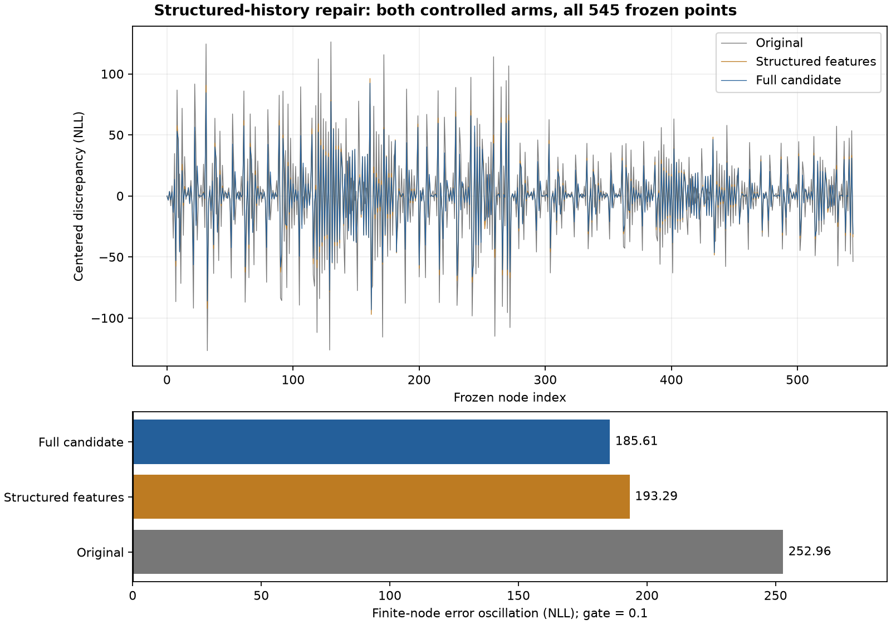

# Structured-history repair: implemented, finite gate not met

**The planned candidate is implemented and qualified, but it does not resolve
the history-fidelity discrepancy.** Both controlled arms completed all 545 frozen
points. The full candidate reduces error oscillation by **26.62%**, from
252.960406 to **185.612242 NLL**, still far above the unchanged **0.1 NLL** gate.
The causal probe was therefore not started. M2 remains open and M3 is unpromoted.

| Representation | Available points | Error oscillation, NLL | Half-radius oscillation, NLL |
|---|---:|---:|---:|
| Preserved original history | 545 | 252.960406 | 126.231763 |
| Structured features, original boundary | 545 | 193.291124 | 96.644816 |
| Structured features, analytic attenuation | 545 | 185.612242 | 92.805402 |

The full candidate's computed-arithmetic interval is
**[185.590608, 185.633877] NLL**. Its failure is not borderline under that
allowance. The two worst points are `r0_pair_04_15_p` and `r0_pair_04_15_m`,
with centered discrepancies -93.240240 and +92.372002 NLL. These are mixed
whitened directions, not isolated physical-parameter perturbations.

See the [decision](decision.json), [verified saved-result review](result_review.json),
[full analysis](full_analysis.json), [control analysis](control_analysis.json),
[execution receipt](attempt001/receipt.json) and [registered plan](plan.json).



## What changed

[features.c](features.c) replaces the joint second-order residual polynomial with
37 structured features. They preserve exact dependence on R0, the three RC
resistances, the three entering RC voltages, H and H·h0. Rates retain quadratic
bases; OCV uses initial SOC and reciprocal capacity internally. Public queries,
support and the common prior remain in the original 16 coordinates, including
the required chain rules. There is no division by H.

Fifteen quadratic, twelve linear and ten origin-invariant features admit an
upper-triangular in-place translation. The 703-entry factor remains 5,624 bytes.
The factor preserves its represented likelihood, including constant residual
energy; translating it still does not reconstruct omitted exact history.

[rolling_model.c](rolling_model.c) computes initial-state attenuation from elapsed
time and two accumulated charge magnitudes in the full arm. Two redundant RC
attenuation-curvature slots hold those charge integrals, and the required RC
curvatures are computed analytically. The control build retains the old
attenuation jets. Forced-response f/hb transport remains approximate in both.

[rolling_engine.c](rolling_engine.c) integrates those features and derivatives
while preserving the input queue, original prior, supported proposal policy,
cost-only workspace contract and once-only evidence ownership. The arithmetic
operation allowance for the new cost path is registered separately. It does not
cover feature/libm, coefficient-construction or recurrence forward error.

The distinct `SHC0001` and `SHF0001` host snapshot schemas reject each other and
the old factor schema. Identical structure sizes do not make their coefficients
interchangeable. This is a separate candidate; original source and evidence are
unchanged.

## Qualification and resources

The final fabricated suite passed **5,260 checks**, including:

- Original-coordinate feature gradients against automatic differentiation;
  zero H, zero amplitudes and exact conditional amplitude dependence against an
  independent physical recurrence.
- Repeated factor translation, cost/gradient preservation, alias rejection and
  preflight rejection of overflow/nonfinite inputs.
- Attenuation and derivatives across mixed signs, rest, zero duration, moving
  rates and underflow.
- Current-block derivatives, original prior, evidence/cursor ownership, bounded
  refinement, queue-full/suffix behavior, counter exhaustion, merge-fault latching,
  cost-only workspace preservation and incompatible bank rejection.

Both context layouts are **8,680 bytes**. Conservative no-inline host project
call paths peak at **712 bytes**, within the unchanged 768-byte project-stack
reservation. With the separate 768-byte runtime/IRQ/caller reservation, the
planning total is **10,216 / 10,240 bytes**. The 24-byte margin is not measured
Cortex-M23 headroom. Target runtime and scheduling latency remain unqualified.
See [qualification](qualification/development003/receipt.json) and
[full-arm memory accounting](qualification/development003/full/memory.json).

The first build's array-parameter declaration failure is preserved. A corrected
suite passed 3,684 checks, then the final suite added explicit edge cases and
passed 5,260. Review is by the implementation agent, not an independent reviewer.
The [qualified source](https://github.com/tumblewhead/mumble/commit/63a1f611c5433427533bdce50914bb74d5a27961)
was published and verified before the two canonical worker invocations.

Each arm consumed the same ordered 252,000 observations and saved accepted-anchor
schedule from the public initial state. Each used 504,000 model steps, 252,000 QR
rows and 16,295 queries, including 545 diagnostic points. Together they took
1.669593 CPU seconds and 1.717500 wall seconds. There were **no optimizer calls,
prior evaluations, truth reads or new original-reference model steps** in these
controlled runs. Previous frozen reference results were reused.

The accepted-anchor schedule belongs only to the external harness. These results
are controlled representation tests, not autonomous learning results. They do not
update the previous capacity/SOC point-accuracy claims. All statuses, raw outputs,
independent capture/bank copies and source/input identities are preserved.

Commands executed:

```sh
python3 -B experiments/structured_history_repair_001/qualify.py --output experiments/structured_history_repair_001/qualification/development003
python3 -B experiments/structured_history_repair_001/study.py --qualification experiments/structured_history_repair_001/qualification/development003/receipt.json --publication experiments/structured_history_repair_001/source_publication.json
python3 -B experiments/structured_history_repair_001/report_saved.py
```

## Remaining discrepancy and next decision

The residual error remains predominantly a slope mismatch: at radii 1 and 0.5,
the full candidate's slope-error norms are 129.4656 and 129.4642. The final
forced-response f/hb values and their first/second jets are bitwise identical
between the two arms. This is consistent with the source: the attenuation change
does not change those forced-response kernels. It improves the measured witness
but does not address all remaining approximations.

The full candidate's endpoint-h discrepancy is 0.00058635 at the anchor; SOC
agrees with the recurrence on all tested points. These are differences between
calculations, not physical-truth errors. Small terminal-state discrepancies do
not establish historical residual fidelity. The remaining error may include
both forced-response transport and nonlinear rate/OCV truncation; this comparison
does not uniquely apportion them.

Retain the qualified candidate as experimental code, without promoting it as a
successful repair. The next bounded step is to separate those remaining terms
using structured-row attribution at fixed early-learning checkpoints before
selecting another representation or boundary change. Reuse existing reference
evidence. Do not retune the gate, shrink the stencil, install the retrospective
oracle, correct slopes from external references or silently forget old evidence.

The original plan requires a passing full-candidate controlled gate before a new
causal probe. That prerequisite failed, so causal execution and the wider
cell/load/noise/duration campaign remain deferred. No calibrated uncertainty,
all-parameter convergence or firmware-readiness claim follows.
