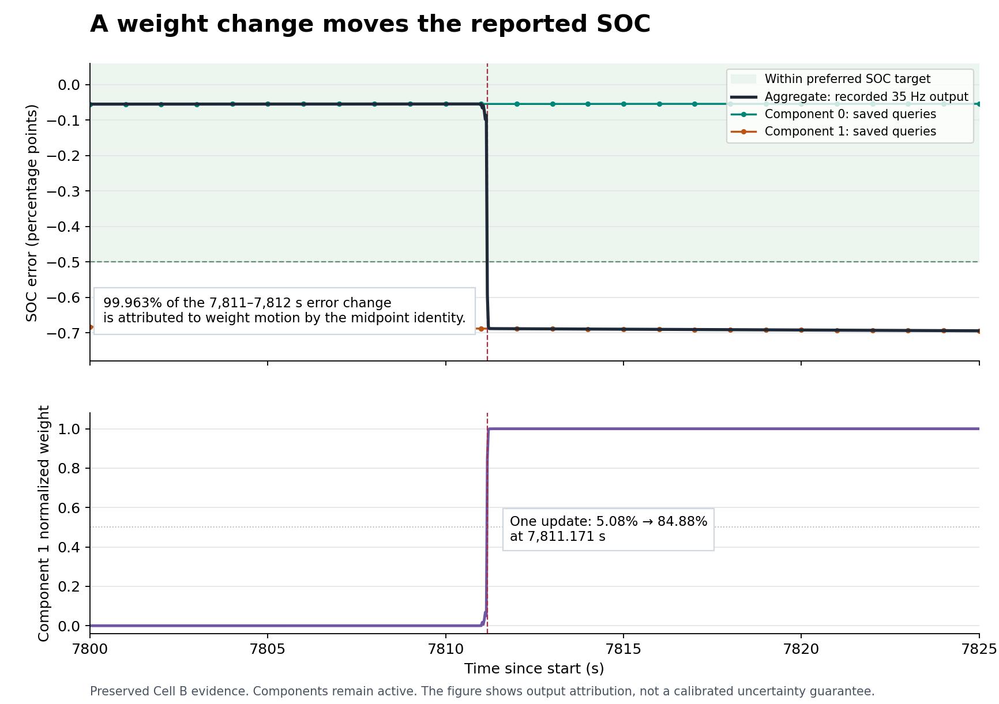

# Weighting and interval diagnostic 001

## Decision

**The bounded saved-evidence audit is complete. No tested weight-arithmetic,
chronology, aggregation or interval-reporting defect was found.** The SOC
excursion is a real change in the reported mixture output. At the saved queries,
predictive voltage residuals drive the component preference. Both conditional
beliefs also report misleadingly narrow local intervals, so changing which
component is reported cannot by itself establish reliable uncertainty.

Close the bookkeeping investigation. Keep the current learner and its original
results unchanged. The next decision concerns the reliability of the predictive
evidence and the uncertainty representation, with one finite design/test contract
before changing weights or conditional inference. The candidate is retained and
is not promoted. No longer campaign is implied.

Sources: [frozen audit plan](../../plans/weighting_output_diagnostic_001.json),
[canonical audit result](attempt001/result.json), [compact summary](summary.json),
[independent review](independent_review.json), and [decision](decision.json).

## What was checked

The base is `b4c57239f163ed0a9a48cf39acf18117915aa4bf`. The plan was frozen before
restoring or reading archived raw records. The reviewed audit source was published
as `c0d9ee7c64335e3dc1105553b6fa1c3b7b03f27f` before execution. The source tree is
`4cb4e2c3c82d106303e8e9e7390259d6b4418637`.

The audit restored only Cell B's recorded scalar metrics, full queries and scalar
truth. All 29 archive pieces and their concatenation were hashed; the three
selected members were verified by SHA-256, Git blob identity and byte count.
150,583,978 bytes were restored outside the repository's original primary
directory. The XZ footer was checked. The [restoration receipt](restoration.json)
and independent review preserve the identities.

The one audit invocation scanned **50,401 scalar rows** in the frozen
7,200–8,640 s context and checked **1,445 full queries**, including the isolated
14,400 s endpoint. It made **152,995 numerical comparisons**, with no mismatch.
There were **zero learner, generator, optimizer or original-scorer runs**.
The full-query stream was read sequentially to select the declared scope;
unselected records were not turned into a new performance campaign.

| Check | Observed result |
| --- | --- |
| Post-query weights versus the next scalar row's pre-update weights | Exact equality; 2,888 comparisons |
| Log-odds recurrence versus recorded score difference | 1,444 comparisons; maximum discrepancy 3.6371e-12 |
| Recomputed predictive log scores | 2,890 comparisons; maximum discrepancy 7.1054e-15 |
| All sixteen aggregate chart means | 23,120 comparisons; exact equality |
| Aggregate marginal standard deviations | 23,120 comparisons; maximum discrepancy 3.4694e-18 |
| Matching local interval endpoints | 17,340 comparisons; exact equality |
| All-component hull and weighted fitted voltage | Exact equality |

These are reconstruction checks under the frozen numerical tolerances. They are
not new physical accuracy requirements or a proof of general correctness.

The indexing distinction matters: scalar record `next_index=n` stores weights
from **before** the update that produced output n. Full query n stores the
**after-update** weights. Therefore query n matches the old weights in scalar
record n+1. Comparing the same index would produce a false discrepancy. The
final query has no following scalar row, so its recurrence comparison is explicitly
excluded; its other checks still run. See
[continuous_probe.c](../../tools/continuous_probe.c) and
[audit_weighting_output.py](../../tools/audit_weighting_output.py).

## The exact output switch

There is one dominance change in the audited context: index **273391**, nominal
time **7,811.171428571 s**. It coincides with the first preferred-SOC failure
already identified by the original scorer.

| Quantity | Immediately before | Immediately after |
| --- | ---: | ---: |
| Component 1 normalized weight | 0.0508353291 | 0.8488418698 |
| Log odds, log(w1/w0) | −2.9269907374 | +1.7255464056 |
| Reported SOC error | −0.0866875457 pp | −0.5923715485 pp |
| Transaction/availability | Valid and available | Valid and available |

The odds increment at this update is **4.652537143 nats**. Detailed per-component
innovation/variance fields were not saved at this exact 35 Hz row. Its total
odds increment is known, but its two score contributions must not be invented
from neighboring 1 Hz queries.

Both weights are representable at this crossing. The source retains finite log
weights and both component states even when a displayed exponential underflows
elsewhere. The immediate crossover is not caused by displayed-weight underflow.
The preserved protocol places it inside constant **+60 mA discharge**, not at a
current-phase boundary; the discharge spans 7,200–8,100 s. See the unchanged
[continuous contract](../../plans/continuous_learning_validation_001.json).

The dense aggregate curve and weights come from the original 35 Hz scalar
records. Component curves use saved full queries. The figure does not interpolate
unrecorded component uncertainty into an all-sample claim.

## Almost all of the one-second SOC change is weight motion

At 7,811 s the component SOC errors are −0.05448945 and −0.68808095 percentage
points. At 7,812 s they are −0.05449043 and −0.68854502 points. Each component's
error changes little, while the aggregate moves from −0.05467387 to −0.68854502.

Write the aggregate error as e=(1-p)e0+p e1, where p is component 1's weight.
With p-bar the midpoint of the two weights, the following is an exact algebraic
identity between two saved snapshots:

\[
\Delta e=(1-\bar p)\Delta e_0+\bar p\Delta e_1
 +\Delta p\,\frac{(e_{1,a}-e_{0,a})+(e_{1,b}-e_{0,b})}{2}.
\]

| Contribution, 7,811–7,812 s | SOC error change |
| --- | ---: |
| Motion of component errors | −0.0002325954 pp |
| Motion of output weights | −0.6336385554 pp |
| Total | −0.6338711508 pp |

The weight term accounts for **99.9633056%** of the signed change. Reconstruction
differs by about 1e-15 points. This establishes the output mechanism over these
saved endpoints. It does not establish why the predictive scores favored that
component or which inference change would be appropriate.

## What drives the predictive preference

The declared score uses the predicted innovation r and variance S before the
conditional correction:

\[
\ell_j=-\tfrac12\log S_j-\tfrac12r_j^2/S_j,
\qquad
\ell_1-\ell_0=
\underbrace{\tfrac12\log(S_0/S_1)}_{\text{log-variance term}}
+\underbrace{\tfrac12(r_0^2/S_0-r_1^2/S_1)}_{\text{standardized-residual term}}.
\]

At the **1,444 saved successful context queries**, the residual-term sum is
**+1,094.0165020 nats**, while the log-variance-term sum is **−0.00554810 nats**.
The total is +1,094.0109539. These are sampled-query sums. They do not decompose
the full 50,401-step odds change of +35,738.3180929 nats.

The frozen focus window gives an especially clear witness. Across the **25 saved
queries with 7,800 < t ≤ 7,825 s**:

| Saved-query diagnostic | Component 0 | Component 1 |
| --- | ---: | ---: |
| Mean voltage innovation | −1.808687 mV | +0.142072 mV |
| RMS voltage innovation | 1.980886 mV | 0.818553 mV |
| Mean reported predictive SD | 1.00003076 mV | 1.00003423 mV |
| SOC error at 7,812 s | −0.0544904 pp | −0.6885450 pp |

The focus residual-term sum is +40.6710517 nats; the log-variance sum is
−0.000086734 nats. The component with lower recorded innovation RMS in these sampled queries has
the worse SOC estimate at the selected endpoint. Voltage prediction quality and
SOC accuracy are distinct obligations when nuisance parameters and hidden states
can compensate for one another.

The small *difference* in the variance terms does not show that either variance
is calibrated. Variance also scales the residual term, and both conditional
state/parameter ranges fail the truth audit. The current evidence therefore does
not justify a variance-floor adjustment, arbitrary likelihood temperature,
forgetting factor, truth-selected component or unique claim about the cause of
the conditional error. The normalized innovation statistics are descriptive
serial observations, not an independent coverage test.

## The remembered confidence issue

The current evidence confirms **truth exclusion**, while each available interval
contains its **own matching point estimate**. All 8,670 selected entity/quantity
checks contain the point. The separate four-arm endpoint check also passes all
24 own-point comparisons. Shared A warm/cold suffixes are not independent
statistical replications.

| Final Cell B quantity | Estimate | Reported local interval | Truth |
| --- | ---: | --- | ---: |
| Capacity | 64.4357304 mAh | [64.4337190, 64.4377418] mAh | 64.7000000 mAh |
| SOC | 42.3198567% | [42.3194111%, 42.3203024%] | 42.3317141% |

Both final point errors meet the preferred application targets. Yet the full
capacity interval is only **0.00402283 mAh** wide around a point with **0.264270
mAh** absolute error; the SOC interval is only **0.000891254 percentage points**
wide around a point with **0.0118574 points** error. These ratios diagnose false
precision in this observation; they are not proposed inflation factors.

Across the 1,445 selected queries, aggregate SOC and capacity intervals include
truth **zero times**. Each conditional SOC interval also includes truth zero
times; component 0's capacity interval includes it eight times, and component 1's
capacity interval zero times. All 24 matching endpoint intervals exclude truth.
The original full-study inclusion counts remain unchanged and are a different
scope. No coverage probability is inferred from either serial grid.

The implementation explicitly constructs local moment diagnostics: SOC mean ±2
SD, and capacity exp(logQ mean ±2 SD). The aggregate capacity point is the
geometric center exp(weighted logQ), not a natural-space posterior expectation.
The all-component hull includes both components regardless of weights and is
also a local diagnostic. At the final B point it contains capacity truth but
still excludes SOC truth. A component-specific interval can exclude another
component's or the aggregate's point; that does not mean it excludes its own
point. Source semantics are in [scm_hypothesis.h](../../include/scm_hypothesis.h)
and the unchanged [uncertainty decision](../../plans/local_uncertainty_decision_001.json).

## Resources, preservation and next decision

The canonical audit took **1.6745 s**, recorded its own peak RSS as **24,027,136
bytes**, and wrote **901,750 bytes** including its receipt. These were inside
the frozen 60 s / 256 MiB / 8 MiB limits. Restoration and report rendering are
separate delivery operations, not new learner trials. The independent reviewer
rehashed the selected archived inputs after the audit and checked derived
digests, counts, seven raw witness queries and the exact crossing rows.

No estimator source, checkpoint representation or estimator SRAM changed. The
old continuous-study supervisor RSS gap remains unverified; recording this
auditor's own RSS does not repair that historical measurement. Full Cortex-M23,
coverage and indefinite-operation qualification remain open.

The selected next action is a **three-checkpoint conditional-belief adequacy
decision**, using the existing 7,200, 8,100 and 8,400 s checkpoints and the next
archived observation at each. Freeze the exact contract before evaluation. A
small positive-weight nonlinear moment probe can compare the retained Gaussian's
linearized forecast with its own nonlinear forecast: 32 spherical-radial points
for each 16-dimensional component, at two components and three checkpoints, for
**192 node propagations plus six centers**. This is a host diagnostic proposal,
not adoption of a different online filter or a coverage claim.

Domain admission must precede every node evaluation. At 8,400 s, component 0's
hysteresis state is exactly **h=1** with nonzero local SD **9.05564e-6** and its h
correction blocked. That is a concrete reason to check whether the local Gaussian
is compatible with the physical domain. It occurs after the weight switch and
does not establish the cause of that earlier switch. Inadmissible nodes must be
reported; clipping or silently renormalizing them would change the diagnostic.

The finite outcome is to prioritize current nonlinear/constraint treatment,
retained historical uncertainty, or explicitly insufficient evidence. Freeze the
comparison scales and resource limits from the declared noise/model before the
probe; do not choose them from truth-error ratios. Even unchanged local moments
would only deprioritize this one-step explanation at these snapshots, not prove
a unique historical cause.

The present result closes normalization, chronology and matching-interval
bookkeeping as explanations in the audited scope. It does not authorize a broad
sweep, longer trace, or a truth-tuned weight repair. See [decision.json](decision.json)
for the continuation and stopping rule. The three-checkpoint probe has not run.
